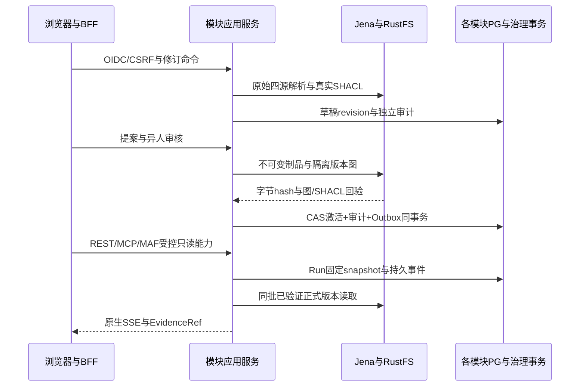

# G2 本地开发、验证与中文运维

仅使用本轮独立 Synthetic 开发身份、图、对象和卷。正式架构见[ADR-009](../adr/ADR-009-g2-semantic-release-execution.md)，HTTP以[真实完整OpenAPI](../contracts/g2-platform.openapi.json)为准；[唯一组件Schema](../contracts/g2-schemas.openapi.json)由模型生成器维护，空paths只代表组件，不能代替运行导出。工具链沿用锁定.NET SDK、Node24.22.1与pnpm11.28.8；不修改全局PATH/SDK，CPM与packages.lock.json、pnpm-lock.yaml冻结恢复。

## 一键与分项

```powershell
# 没有占用既有固定开发端口时：新私有runtime/PFX、新卷、新Realm，完整工程/真实容器及浏览器验收。
pwsh -NoProfile -File scripts/acceptance/g2-thin-slice.ps1 -StartRuntime

# 已启动本轮G2栈时：显式传该checkout生成的私有runtime路径，不能传历史G1配置。
pwsh -NoProfile -File scripts/acceptance/g2-thin-slice.ps1 -RuntimeFile .tools/security/<本轮g2目录>/runtime.json
```

私有runtime只留ignored .tools/security，不输出其内容、不提交或打包；.tools路径由prepare实际返回，示例不是已有凭证。固定端口被占用会停止相应启动，不清理他人进程/卷。Docker必须为现有可用Engine；不安装系统软件。结束保留本轮卷供恢复，不执行prune。

分项入口都在scripts/acceptance：semantic-roundtrip.py（--postgres）、shacl-validate.py、draft-revision.py、release-faults.py、query-plan.py、mcp-agent.py、sse-replay.py、full-g2-e2e.py（--runtime-file）、g1-regression.py（--runtime-file）、performance-baseline.py（显式新run或--from-observed-run）。g2-integration.ps1使用唯一批准Dockerfile建立精确Jena夹具，依次运行四模块真实临时资源测试；G1安全另用test-governance.py。--filter只证明选中项，0测试不能通过。子集入口会重用同一真实夹具，不额外虚构测试数量。

G2产品LGTM由g2-observability.py验证，Trace链接由g2-trace-browser.mjs以精确项目Node运行，健康故障由g2-readiness-fault.py验证；完整一键编排包含这些门禁，独立回执/实际运行见本轮证据，不把脚本存在当通过。CLI会保留明确失败并返回非零。

## 权威边界与恢复



四源原文/hash按UTF8位置保存，vocabulary absent与空串不同；隐式BASE固定且不联网导入，未知公理保留或阻断。画布布局不改语义。服务器强If-Match与Command.expectedRevision一致；409保留本地文本，先读远端比较，显式丢弃才替换。审核/激活/cancel的头也取Command修订，activationRevision是另一条PG CAS条件。写命令不自动重试，确需恢复时复用原command/idempotency/payload读取已提交回执。

外部就绪后才PG原子激活。失败保留旧active与历史图；Outbox按租约/fence调和。回滚是独立提案和异人审批，绑定目标release/manifest，与当前草稿revision无关，activationRevision继续递增。未确认的失败不手工删图/对象或改PG指针。专业排障先读取真实回执、审计/Outbox、正式release及健康状态，避免以重试猜测成功。

Run仅由服务器身份、完整范围和正式目录建立快照；SSE先存后发，Last-Event-ID为runId:seq。25秒重连上限/慢端断开不等于cancel；明确取消走独立CSRF+CAS命令。重新读取会话与owner/scope，注销后不沿用旧票据。旧Run在新发布/回滚后仍保留旧snapshot；证据每次打开都重新授权并核验源/版本。

## 诊断与未验收边界

页面的非零32hex TraceId链接定位本地Grafana platform-tempo。HTTP发布/查询span与原生宿主父链真实关联；后台execution.run另建真实Trace，以execution.creation_trace_id绑定持久创建Trace，不能伪造缺失父span。在Tempo按该tag搜索可定位MAF/Gateway后台链；g2-observability原始结果验证这一关联。Loki只索引服务/环境/版本；四模块指标只允许有限键和值，asset/run/trace/用户/厂区/原文不是指标维度。Prompt、Turtle、原始异常、令牌和连接串不进遥测；PG审计与日志分开。

受X-Health-Key保护的/health/ready读真实治理/三个模块表，探测Jena/RustFS；整体两秒，DB握手预留取消预算，原生Npgsql健康专属配置不改业务连接。GSS有效强制要求和TLS不能降级。真实Jena/RustFS/PG暂停只对该runtime卷定位的唯一容器执行，finally恢复；禁止在生产执行该验收。

deterministic harness必须Development+显式开关，真实运行MAF函数工具循环但不代表LLM推理。真实模型BLOCKED且不调用收费服务；Monaco按用户决定继续暂停，原生源码备用编辑明确无高级补全。Windows原生/Intel Mac/生产/HA/五真实源及正式SLO维持NOT_RUN或NOT_VERIFIED，Linux以实际最终同Head job为准。性能为本机合成样本，报告输入尺寸/环境/样本分布，不承诺生产阈值。结束交付唯一Review ZIP并等复审，不启动G3–G8。
