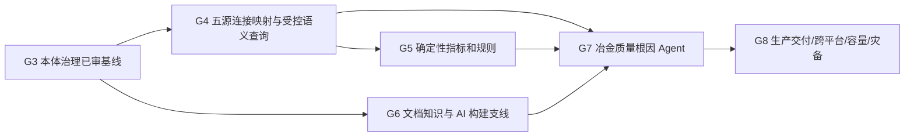

# 01 · 已有事实、当前状态与 G3→G8 交付主线

## A. 事实与授权分级（截至 2026-11-01）
- Github `on-dotnet/ontology-platform` 的 `main=d1a61daffe844475b07705797e3ad325cc3f2945`（本次通过连接 GitHub 的 branch 查询确认）；G3-M5-REVIEW-FIX-001 完成独立复审。G0/G1/G2 作为此前已实施基线，不解释为所有生产环境、Windows 或 CI 已通过。
- G3 使用 RDF/RDFS/OWL2、SHACL1.0、SKOS、PROV-O、Turtle 为正式语义；PG+Jena/Fuseki+RustFS、G3 原始四源 SourceBundle、历史 Release、G3-M4 身份/时间/impact 审批不能改写。**不使用 TMDL、Microsoft GraphRAG、默认 Neo4j、Agent365、AutoMapper 或对生产源任意 SQL/写入**。
- `ActorContext` 从可信 OIDC claims 构造，具有 organization/site 过滤，`CommandContext` 幂等/版本锁和审计，唯一 Semantic Query Gateway 六态 `FOUND/EMPTY/PARTIAL/UNAVAILABLE/UNAUTHORIZED/AMBIGUOUS`，MCP 工具受白名单与预算保护。这是现有事实；G4 扩展必须逐个裁决，不可复制一个不兼容的新 Gateway。
- G3 的 `dataTurtle` 仍是 Synthetic 正式发布模型的一部分。**G4 生产数据不能被转储成它、也不能在不具单独知识发布合同前写 G3 正式图**。G4 默认虚拟/按需源查询、可选受控缓存，不改变原系统。
- G6-00 AI Native 知识构建产品设计与 V1.1 商用、Docker、多模型方向已获批准；`G6-P0-PARSER-PREP-001`、`G6-P0-DEPENDENCY-LOCK-001` 在实验分支完成受限准备，Docling 完整安装闭包仍受阻。G6 PREP Head=`851fa7eb2153c660b7989c0a7a6dd0e1c8e1b63c`、LOCK Head=`72a88341c634f971ed0a30a1e63a974f957cbb05`，**均非 main 的当前产品代码**。
- 这次用户**只授权 ChatGPT** 制定 G4-00 正式合同、验证设计和准备后续 Codex 输入。没有授权 Codex 自动实施或启动 G4-M1。

## B. 主线 DAG

**关键路径**：G3→G4→G5→G7→G8；G6 在 G7 合流，持续受自身 ADR/许可条件约束，不能长期挤占 G4 公共合同 owner。

## C. G4 可交付 M0~M5（建议按小闭环而非五个驱动同时造）
| 关口 | 价值/退出状态 | 真实验证 | 不扩大范围 |
|---|---|---|---|
| **G4-00-CONTRACT-001** | 产品/页面状态/权限/错误/五源配置/Schema/Mapping/Query公共合同/部署计划冻结 | 独立合同 Review、反例推演和可核对计划 | 本轮只制定输入包，Codex 尚未获准 |
| **G4-M1-CONNECTION-001** | 配置→测试→保存→编辑→重试→禁用→审计；先 PG 真实纵向切片并实现五种类型 UI Schema | 隔离 PG 真实读及一组受控 HTTP 反例，其他四源的真实可用性分别记录 | 不偷跑 G4-M2；驱动/镜像需单独审批 |
| **G4-M2-CONNECTORS-001** | Oracle/Doris/TDengine/WebAPI 的真实连接 + schema/capability discovery、只读保障 | 四源独立适配、数据类型/协议及错误正反 E2E | 无可用环境真实 NOT_RUN，禁止模拟出关 |
| **G4-M3-MAPPING-001** | Schema→AI 推荐→字段与身份映射→专家审核→版本发布→对账 | 跨厂同号、单位/时间、缺字段/Schema漂移、审核冲突 | 不改 G3 本体 Release，不自动发 schema |
| **G4-M4-QUERY-001** | 受控跨源 Gateway/Capability/QueryPlan/证据/水位/预算/超时/取消/六态 | 同一 actor 真实跨源权限、部分失败和分页 E2E | 无任意 SQL/SPARQL/URL 暴露 |
| **G4-M5-INTEGRATION-001** | 5源→转炉/精炼→连铸→轧制谱系与查询；闭环 UI 和 Gateway 兼容 | 五源覆盖矩阵、Docker ARM64/AMD64、浏览器、安全/回滚/资源真实记录 | G5/G7 另授权，不伪造生产联接 |

**实施建议**：先冻结共同合同和首条 PG 全流程，再把其他数据源插入同一抽象；只在真实测试证明共性时复用协议。G4 完成后才按阶段授权 G5；G6 根据真实 PoC 并行、每关独立审核。

## D. 后续阶段的消费关系
- G5：生产数据真实读取，基于映射发布版本、可复现 source watermark 和精确单位/时间语义计算指标；公式/规则执行确定性，AI 只生成建议。
- G6：DocumentVersion、Claim、KnowledgeRelease 独立治理，文档事实与 G4 源实测事实不可混写；只在 Agent Context Pack 查询阶段融合。
- G7：Q235B 质量异常根因分析，G3 本体导航 + G4 实测谱系 + G5 指标规则 + G6 工艺规程/证据；输出假设/反证/未知，禁止无根据因果。
- G8：Compose 一键部署（单节点）与真正多实例高可用分别验收、Mac ARM64/Windows WSL2 AMD64/Linux AMD64、业务并发和恢复、审计密钥、SLO、RPO/RTO、SBOM/许可/离线交付。目标约 100+ 采点、200+ 用户并发查询是未来负载验收需求，不是当前已达标声明。

## E. 决策继承与 OpenADR
已确认：五源 PG/Oracle/Doris/TDengine/WebAPI 必须支持；生产只读；模型服务多 Provider、用户授权外联；前端 Next.js/shadcn+Tailwindadmin 彩色设计；后端 .NET10 模块化单体+统一 Semantic Gateway；本体/RDF 权威不变；真实 Docker 资源 task-level 生命周期。
待在 G4-00 合同审查时定准：`G4-ADR-01` G4 PG 元数据及凭据模型、`02` 五源 Adapter/SQL AST 受控方式、`03` Web API OpenAPI ingest 安全边界、`04` Ontop 对比时机与回退、`05` 映射/快照独立治理、`06` 水位/分页/部分失败及缓存策略、`07` G4 审计动作/审批、`08` Docker 跨平台真测次序。所有 ADR 目前 **PROPOSED**。
