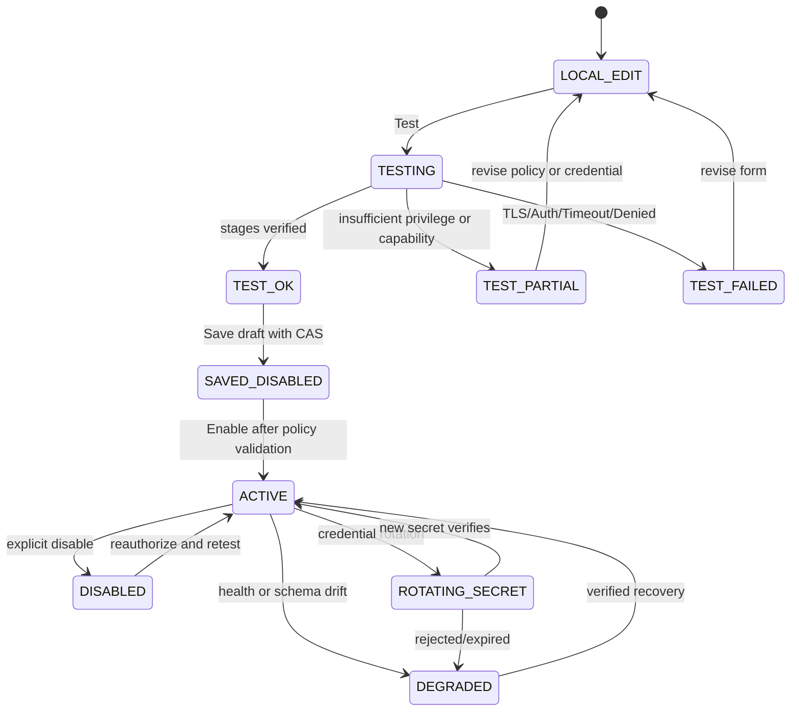
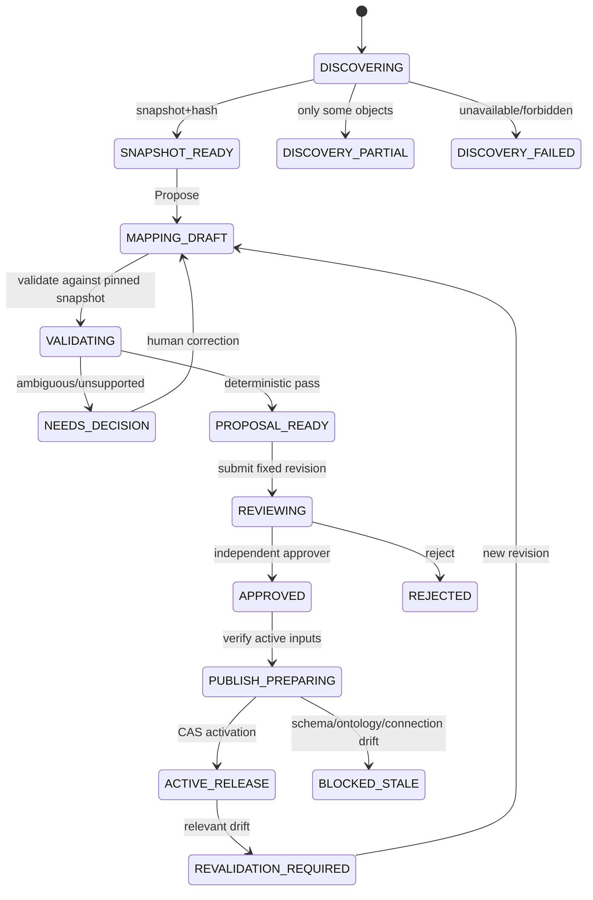

# 03 · G4 页面、交互、状态与产品验收矩阵 V1.1

> **PROPOSED / NOT_IMPLEMENTED**。所有路由是 UI 规划占位名，应由 Codex G4-00 查实现有 Next App Router 后最终冻结，不作为当前已存在 URL。建议复用已有 Navigation/Shell/Design Tokens，**不再引入新 UI 库或复制商业模板**。字段校验、loading、empty、权限拒绝、429/503、并发冲突及失败恢复是每一项必有能力。

## 1. 页面与弹层图（13 个界面单元）
| ID | 建议 URL/容器 | 用户 | 主要展示、可操作行为 | 关键状态与异常 | 真实交付后可观察证据 |
|---|---|---|---|---|---|
| U01 | `/data/connections` | 数据管理员 | 五源列表、名称/类型/环境/厂区/状态/最后测试/Schema版本；搜索筛选、添加、进入详情、禁用 | 空、加载、权限隐藏、分页、行操作冲突 | 新增返回列表、筛选精确、无权不可见 |
| U02 | `/data/connections/new` 3步向导 | 数据管理员 | 类型卡片→动态表单与 SecretRef→测试/确认；五类型不同字段、前后端同 Schema、字段提示 | URL不合法、端口范围、TLS错误、前进/返回保持非密输入 | 五类型正/负表单、前后端约束一致、凭证不回显 |
| U03 | `/data/connections/{id}` 详情 | 管理员/审计 | 基础配置（脱敏）、状态、最近测试、可见 schema 范围、关联Mapping、使用情况；编辑/复制配置/更新Secret/禁用/启用 | Secret仅“已配置/需更新”，过期重测、版本CAS409 | 修改即 invalidates stale tests，关联 Mapping 告警；GET无敏感文本 |
| U04 | 连接测试抽屉 | 管理员 | 分阶段网络→TLS→认证→只读授权→元数据能力；耗时、Trace/诊断、重新测试 | 测试中、PASS/PARTIAL/FAIL、取消、超时、403/503、环境不可达 | 测试不写库、stage failure reason，可清除旧结果、不伪PASS |
| U05 | `/data/catalog` | 管理员/专家 | 树：源→catalog/schema→table/view/supertable/API operation；字段 type/nullable/PK/时区/单位/敏感性候选；刷新 | 0对象/未授权/部分对象/metadata禁止/超预算 | 显示确实可见对象；自动分页；失败保留旧快照只读标记 |
| U06 | 模型变更抽屉 | 专家 | `SchemaFingerprint` vA→vB、字段新增/删除/类型变化、Mapping引用和风险影响、去重处理 | no-change/stale/unknown/partial；受阻字段高亮 | 漂移后旧Mapping不能误使用；可定位受影响字段 |
| U07 | `/data/mappings/new` → `/data/mappings/{id}` AI 工作台 | 专家 | 左源对象、中本体候选和字段连线、右风险/证据；AI推荐、批量接收/拒绝、保存修订 | 无模型可手工/规则推荐、超限、AI未授权、术语冲突 | 无模型可用；低风险/高风险按规则区分；候选有明确来源 |
| U08 | 映射问题决策抽屉 | 专家 | 相同号跨厂、单位不明、时间粒度、数据类型和关系方向；看源证据、选择纠正/跳过/暂缓 | 待决策/多人编辑409/禁用的 source/无法证明 | 关键身份与单位异常不能一键忽略；审计决策原因 |
| U09 | 映射验证/对账页 | 专家 | schema/model hashes、字段类型兼容、identity唯一性/歧义、抽样（授权后）、计数/覆盖率；返回定位 | PASS/FAIL/INDETERMINATE/NOT_RUN，样本0≠PASS | 未运行真实数据不显示通过；无法确定阻止发布 |
| U10 | `/data/mappings/review/{proposalId}` | 非作者审核者 | 固定Rev/SourceSchema/OntologyRelease/ImpactHash；diff、风险清单，批准/驳回及原因 | 审核过期、self-approval403、源变更409、另一人已决定 | 批准只影响固定提交，变更后旧审批失效 |
| U11 | `/data/mappings` 版本目录 | 专家/审核者 | 映射列表、Draft/Released/Active/Deprecated、关联源与本体、回滚提案 | 版本并发、撤销源、发布中断 | 激活CAS与审计，回滚需批准，不覆盖历史 |
| U12 | `/data/explore` | 质量分析员 | 中文问句、实体/厂区/时间筛选、可视化QueryPlan、表/时序/谱系、结果六态、反馈 | 同号歧义AMBIGUOUS、多个源PARTIAL、全失UNAVAILABLE、无权UNAUTHORIZED | 不会自动选厂、不泄露禁用源；证据可打开且权限重校验 |
| U13 | Query诊断/证据抽屉 | 授权用户/运维 | 子源执行树、源耗时、水位、limit、retried、Trace、遮蔽的RecordRef、导出审批 | 404/403/取消/游标过期/显示失败 | 多源耗时可定位，源真实错误不暴露内部SQL/Secret |

## 2. 五类数据源字段/UI 的局部差异
**U02 由类型驱动，不是一套通用“Host+URL”。**
| 类型 | 首屏必须填 | 可折叠安全/高级配置 | 表单独有验证 | 后端试连必须可观察 |
|---|---|---|---|---|
| PG | host/port/db/user/secret/组织与允许站点 | TLS CA/mode、schema allowlist、pool、超时 | 数据库非空；禁止任意连接字符串注入 options | SSL、认证、schema visibility、readonly role |
| Oracle | host/port/serviceName/user/secret/ownerScope | TCPS、Wallet SecretRef、fetchSize、numeric precision | serviceName与 SID/alias 明确三选一；wallet引用不从客户端文件路径复制 | driver/native 兼容、owner/columns、凭据拒绝 |
| Doris | FE host/port/catalog/database/user/secret | TLS、读取上限、decimal与日期兼容标识 | FE查询端口不是 BE HTTP 端口；catalog/type 二级选择 | MySQL wire 连通、Doris版本/功能探测 |
| TDengine | WS URL/db/top-level secretRef（profile无credentialRef） | timezone、timestampPrecision、stable/subtable/tag 发现 | websocket scheme、WS TLS、数据时间窗口必填 | adapter/edition/WS、精度、标签列 |
| Web API | 固定 baseOrigin/operation/spec/认证方式；NONE时 secretRef=null | headers allowlist、pagination、JSONPath字段、SSRF策略 | 禁 URL userinfo/fragment/非允许跳转/私网越权；默认GET | 目标DNS与IP预授权、TLS、契约响应、分页可用 |

## 3. 实际状态转移：连接

禁止：`TEST_FAILED → ACTIVE`、`DISABLED → QueryExecution`。可以保存未测试 Draft，但 UI 不称为可用数据源。`TEST_OK` 绑定 `(configHash, secretVersion, schemaScope, time)`，任一变化使过去的 PASS 过期。

## 4. Schema/Mappings 版本转移

查询旧版本保留审计快照，但 source revoked/ACL revoked 后不继续暴露旧数据。`REVALIDATION_REQUIRED` 不意味着可以 silently fallback 任意列；可以拒绝某字段/局部返回 PARTIAL。

## 5. 查询六态一致显示规范（复用 G2 返回概念）
| 状态 | 标题 | 显示行为 | 下一个用户动作 | 安全约束 |
|---|---|---|---|---|
| FOUND | 已找到结果 | 数据+证据+读取水位+版本；有界分页 | 查看详情/溯源/调整条件 | 必需源完整且未截断；不可将部分视为FOUND |
| EMPTY | 当前条件无匹配 | 显示成功检查的数据源和范围 | 更改时间/厂区、清除条件 | 必需源全部成功且确认无行 |
| PARTIAL | 部分来源可用 | 能显示可信子结果、缺少的数据及限制 | 稍后重试缺失源/缩小查询 | 不用缺失列补0，不在UI隐藏失败 |
| UNAVAILABLE | 数据暂不可用 | 无可信结果与错误类别、Trace | 重试/联系管理员 | 超时、连接断开不冒充EMPTY |
| UNAUTHORIZED | 无权访问 | 不显示可识别跨scope候选 | 申请访问、切换自己有权厂区 | 身份来自服务端，HTTP 401/403规则保持 |
| AMBIGUOUS | 存在多个合法候选 | 展示已授权候选与区分依据 | 明确选择厂区/实体/时间 | 不按同名或重复炉次号合并 |

额外状态：`VALIDATING/PLANNING/EXECUTING/CANCELLING/CANCELLED` 属运行进度，不替代业务六态；错误对象含稳定code、traceId、retryable、userMessage，不回显SQL/URL/Secret。若客户端收到499等代理网络错误，必须查询 Run 决定是否仍在进行，不能自动重放并重复耗费源资源。

## 6. 页面操作与后端命令闭环（拟议 API；详情见05）
| 页面动作 | 操作合同 | 成功 UI | 失败行为 |
|---|---|---|---|
| 创建并测试 | `POST /connections/tests`（绑定不保存的安全Draft） | 阶段报告/Trace | 网络/登录/权限分层失败，草稿不丢失 |
| 保存连接 | `POST /connections` / `PATCH ...` CAS | 行显示已保存，测试可能需重验 | 409 提示实际新版本并提供比较，不静默覆盖 |
| Secret轮换 | 独立服务器命令 + SecretRef版本 | `已更换，需测试` | 旧值绝不回显；新值验证失败保留受控恢复路径 |
| Schema发现 | `POST /connections/{id}/discoveries` → Job | 显示进度/目录/哈希 | 取消/断线可恢复，失败时保留上一次可验证快照 |
| 接收映射建议 | `PATCH /mappings/{id}` CAS + If-Match + CommandContext | 更新 diff/待审数 | 冲突后提供未保存内容导出，不自动覆盖 |
| Mapping审核 | `POST /mapping-proposals/{id}/decisions` | 状态更新/审计ID | 异人拒绝/过期/错版本明确提示 |
| 激活映射 | `POST /mapping-proposals/{id}/activate` | 新 active版本可查询 | source/schema变化保持旧active并标明失败 |
| 查询 | `POST /data/semantic-queries` G4QueryResultV1 typed plan only | 六态/证据/分页 | 超预算/取消/源失败按 G2 规范分类 |
| 查看证据 | `GET /data/source-evidence/{id}` | 允许的记录/字段与来源 | 任何授权撤销后即时拒绝，不依赖旧Token |
| 禁用源 | `POST /connections/{id}/disable` | 任务与依赖风险提示；禁后不可新查询 | 已在执行中的请求按策略取消/完成审计，不能后台继续新调度 |

## 7. 关键可用性细节与设计验收
- 输入项、按钮必须具备 disabled/loading/progress/error/success；Enter/Esc 与键盘操作、焦点恢复、危险操作二次确认；提示语靠近字段而非顶层冗余技术说明。
- 列表 URL 与筛选状态可分享但不能含 Secret；后退保持非敏感草稿；错误页不会丢失用户已审核的 proposal 决策。
- 权限变化不依赖前端隐藏按钮：服务端重校验。跨厂同号试验必须提供可观察 `AMBIGUOUS` 和不越权的候选。
- AI 暂不可用时仍可通过本体目录和显式字段映射完成提案；平台不给业务用户暴露 SQL/SparQL 画布。
- Schema 过期不自动刷新时也必须有明显状态和重验操作；定时探测不是对源无限轮询。
- 用户收到 `PARTIAL` 时有 `已取得结果/未取得结果/受限原因` 结构化摘要，绝不把“0行”当源故障的默认展示。
- 真实浏览器 E2E 应覆盖全部 13 个单元核心路径、至少 light/dark/1440/窄屏 4种可观察情况（门槛与截图数量在 M 阶段确定）；本次只有设计，NOT_RUN。

## 8. G4-00 V1.1 页面恢复路径与读取合同核对

| 用户从哪里来 | 首次读取 | 关键动作 | 刷新/跨用户恢复时读取 | 失败/权限处理 |
|---|---|---|---|---|
| U01→U02 新连接 | 已登记连接类型 Schema；专用凭据通道签发 SecretRef（Web API NONE 为 null） | `POST /api/v1/connections`；请求 `config/type/profile+secretRef+command(expectedRevision=0)` | `GET /api/v1/connections/{id}` | 创建未成功保留非敏感表单，绝不回显密钥 |
| U11→U07 新映射 | `GET /api/v1/connections/{id}/catalogs` + 固定已发布 G3 本体 | `POST /api/v1/mappings` → `PATCH /api/v1/mappings/{id}` | `GET /api/v1/mappings/{id}`；`GET /api/v1/mappings/{id}/revisions/{revision}`；`GET /api/v1/mappings/{id}/diff` | 409 后先比较并保留用户未保存内容 |
| U07→U09 验证 | `GET /api/v1/mappings/{id}` 固定 revision | `POST /api/v1/mappings/{id}/validate` | `GET /api/v1/mappings/{id}/assessments?revision=...`，`GET /api/v1/mapping-assessments/{id}` | 不得把旧修订通过结果当新修订结果 |
| U11→U10 待审 | `GET /api/v1/mapping-proposals?status=PENDING` | `POST /api/v1/mapping-proposals/{id}/decisions` | `GET /api/v1/mapping-proposals/{id}`，固定草稿修订、Diff 和 Assessment | 自批403、审批过期、Schema漂移409 |
| U11 版本与回滚 | `GET /api/v1/mapping-releases?mappingId=...`、`GET /api/v1/mappings/{id}/active` | 回滚提案→异人审批→CAS激活 | `GET /api/v1/mapping-releases/{id}` | 历史仍可读，但源撤权不允许偷看行级证据 |
| U12→U13 查询与证据 | `POST /api/v1/data/semantic-queries` 返回 `G4QueryResultV1` | 候选选择后固定IRI/厂区再查询 | `GET /api/v1/data/semantic-query-runs/{id}` 与 `GET /api/v1/data/source-evidence/{id}` | AMBIGUOUS必须给可分辨候选和证据；当前ACL撤权则阻断 |

`U10` 固定 Review 快照来自服务端，而非仅在前端记住某个 `draftRevision`。列表筛选不在 URL 携带 Secret。新版 G4 结果中的 `candidates/evidence/validTime/observedAtUtc/diagnostics` 均有正式候选结构；不得把 G2 `EvidenceRef` 强制替代为真实源数据的伪图对象。
