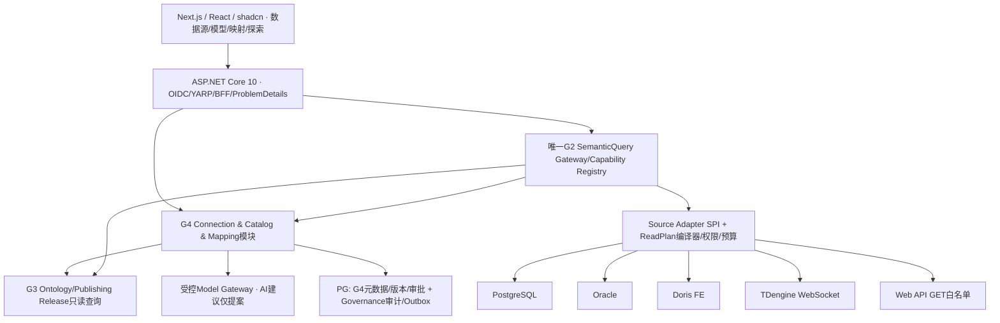

# 04 · 五类连接器精确技术、元数据、兼容性和故障矩阵

> 此处**官方可验证事实**与**G4 推荐实现方案**分开。官方支持的功能仍需在 G4-M1/M2 中以实际目标版本、TLS、源角色、Docker Linux ARM64/AMD64 验收。**未知的厂商版本/授权不得伪造为可用。**

## 0. 统一模块架构（Next.js前端 + .NET10模块化单体 + 专业Source Adapter）

前端沿用 Next.js App Router / React 19 / TypeScript / Tailwind / shadcn 与 Base UI；表单可按已批准技术栈使用 React Hook Form + Zod，服务端状态 TanStack Query、少量会话状态 Zustand、图谱 Cytoscape.js，**不因为G4再安装新组件框架**。后端沿用 ASP.NET Core 10 / .NET 10 / EF Core 10（只用于**平台元数据**），源数据读取使用各自有界 ADO.NET/HTTP/WS Adapter，不强迫所有源通过 EF 建模或迁移。G4 以模块化单体整合 Gateway，专业源驱动在获得许可后以隔离适配器接入，首期不引入新微服务和第二个通用查询引擎。

G4元数据由自己的 PG schema拥有，审计仍归Governance，源的表/字段属于外部系统，不在G4 EF中成为由平台管理的业务表。G4的Mapping是将外部源字段关联**现有G3本体**，不是替换RDF/OWL的JSON/TypeScript语义元模型。异步 Schema发现和对账属于 G4 持久 Job，Run/Lease/Fencing采用经审批的可靠运行模式，不由UI请求连接无限等待。

## 1. 统一适配层边界

`ISourceConnector` 只是 G4 模块内的受限 SPI；不是全平台通用 SQL 引擎。每个 Adapter 必须实现声明式能力 `DescribeCapabilities`、`Probe`、`DiscoverSchema`、`PrepareReadPlan`、`ExecuteReadAsync`、`Cancellation/Diagnostics`。所有方法需接受服务端 ActorScope、连接绑定版本、查询预算及命令/Trace 上下文；用户不可直接输入目标 SQL、SPARQL、URL 或任意 URI。

`ReadPlan` 由注册的 MappingRelease 与受控逻辑查询生成，必须是类型化只读计划：字段投影/允许对象/服务端生成的参数表达式/有界时间窗/排序与游标/最大行数；适配器独占 SQL Dialect 或 HTTP 请求模板渲染。**即便文本为 SELECT，也不能作为安全判定依据**（函数、副作用、注释、多语句、源方言、隐藏引用、视图权限等）。源端账号只授予必要对象的 SELECT，连接端口网络和 TLS 进一步限制。

关键不变量：`
AuthorizedScope ∩ ConnectionScope ∩ MappingScope ∩ SourceDataPolicy`，任一不充分则 fail closed。跨数据源不是直接 join 不同 ID；应由 G3 IdentityClaim 规则/已发布映射显式产生有出处的统一实体键。

## 2. 各源技术矩阵

| 维度 | PostgreSQL | Oracle | Doris | TDengine | Web API |
|---|---|---|---|---|---|
| 首选 .NET Adapter | Npgsql ADO.NET（版本另批） | Oracle.ManagedDataAccess.Core（商用许可复核） | MySqlConnector 走 MySQL wire，并适配 Doris 差异 | TDengine.Connector **WebSocket**（版本匹配） | `IHttpClientFactory`/强 allowlist + Schema Codec |
| 连接元数据 | host/port/db/schema/tls/role | service name/host/owner/tcps/wallet | FE endpoint/catalog/db/tls | WS endpoint/db/stable/subtable/tags/timeprecision | base origin/allowlisted operation/spec/headers/auth/pagination |
| 发现 | `information_schema` + 必要 `pg_catalog` 受限读取 | `GetSchema` / `ALL_*`（仅有权限可见）；不默认要求 `SELECT_CATALOG_ROLE` | `information_schema` 和已注册 SHOW、Doris 特有 catalog | `information_schema.ins_*`、受限 `SHOW STABLES`/`DESCRIBE`、标签和时间语义 | 管理员上传/授权的 OpenAPI，验证过的 JSON 样本结构；不可任意远端 `$ref` |
| 参数化 | DbParameter，引用受控标识符 | OracleParameter（绑定方式核验） | MySqlParameter，Doris 方言适配 | Connector 参数化或服务器生成受控只读语句，按实测能力 | 服务端定义 path/query 参数，编码且不可改目的地 |
| 只读防线 | 源账号只读+事务 READ ONLY（针对适用情况） | 源账号最小 SELECT；禁止 PL/SQL执行/匿名块；视图权限 | 源账号 SELECT+SQL AST白名单，不通过FE导出/Load/管理功能 | 账号只读、语句及时间窗白名单；REST SQL POST不能当通用WebAPI | GET by default；无副作用查询 POST 需逐 operation 认证且另批 |
| 分页 | 唯一排序键+keyset优先，OFFSET 有界 | 经目标 DB 版本验证 `OFFSET/FETCH` 或键集 | limit/order+keyset 可用性实测 | 时间戳+稳定标识，时间窗口/时序分块 | 显式 `page/offset/cursor/link` 注册，next URL 同域再验证 |
| 时间类型 | `timestamp with time zone` vs `timestamp` 区分 | DATE、TIMESTAMP、WITH TIME ZONE/LOCAL TIME ZONE 要保留语义 | DATETIME/DATE 与时区一般由外部合同确定，不自猜 UTC | 纳秒/微秒/毫秒精度按数据源与连接记录；STable tags | ISO8601 严格解析；无 tz 返回 `UNKNOWN_TIMEZONE` |
| 类型边界 | numeric/uuid/jsonb/array/bytea | NUMBER 精度/scale、CLOB、RAW、DATE | DECIMAL/JSON/date/ARRAY 等按实际版本能力 | TIMESTAMP、TAGS、NCHAR、DECIMAL、BLOB | JSON number 精度、null/missing、array cardinality、枚举 |
| 独立故障 | search_path 越界/锁超时/role变化 | service alias/TNS、权限视图、网络加密、License | FE故障、MySQL兼容差异、catalog变动 | taosAdapter不可用、WS超时、时区/精度 | SSRF/DNS rebind、OAuth过期、429、pagination loop、schema drift |
| 验收条件 | 真实只读 PG＋401/403+跨schema负例 | 真实 Oracle docker/测试实例或经授权远程隔离源；环境缺失 NOT_RUN | 真实 Doris FE + 时区/类型/权限及兼容负例 | 真实 WS/adapter + stable tags/precision/time filtering | 本地恶意模拟服务 + 合规远端仅经显式批准 |

### PostgreSQL
官方 `information_schema.columns` 仅显示当前用户可访问的列，不等于全库全部字段；遇权限缺失不能把 schema 为空解释为“数据库无数据”。事务 `READ ONLY` 是额外保护，但最小数据库角色仍必要。查询不能依赖共享 `search_path` 自动解析同名表；schema/table/column 都从已发现对象精确标识符集合渲染；参数只绑定值，不能拿 DbParameter 绑定标识符。事务超时与取消应在连接/命令中一致传播。参见 PostgreSQL 官方 `information_schema` 与 `SET TRANSACTION`。

### Oracle
官方 `OracleConnection.GetSchema` / Oracle data dictionary 能提供不同粒度的 schema 信息，字段列表与可见性受账号角色限制。首期按已授权 owner 和 serviceName 发现；不能为省事使用 SYS、`SELECT_CATALOG_ROLE` 或导入任意数据库连接描述符。`NUMBER(38,...)`、`DATE` 时间部分、NLS、大小写 quoted identifiers、CLOB 截断要独立验收。Oracle 驱动 NuGet 商业分发和 Linux/ARM64 的目标版本必须经许可及兼容审查，而不是“ODP.NET 是托管库”就宣称跨平台 PASS。任何需要企业现有 Oracle 实例的真实实验须确认由用户授权提供的只读账号。

### Doris
Doris 官方 4.x 文档明确 FE 暴露 MySQL 协议，默认查询端口 9030，但 Doris 与 MySQL 在数据类型和 DML/DDL 行为有差异。建议 `MySqlConnector` 仅作为传输层，不引用普通 MySQL 语义推理；为 `catalog/database`, nullable/decimal/time、执行超时、HTTP FE 管理端不可混入查询口做专门能力测试。禁止使用 `SELECT *` 对无限 OLAP 结果拉取，服务端投影字段和固定预算；不能通过普通 MySQL 迁移模式验证 Doris 兼容性。

### TDengine
官方 C# 连接器网页提示原生连接将于 **2027-01-01** 下线，推荐 WebSocket；因此 G4 直接以 WS 为目标，严禁把 native 6030 视为“先上线以后迁移”的默认方案。TDengine 时序数据的 `ts` 精度、stable/subtable/tag 层级、窗口及采点水位单列合同。REST API 通过 POST body 输入 SQL（是特殊协议），不得误将其归为普通可任意 POST 的 Web API 连接器；若需要 REST fallback，要经过单独 Adapter 设计、严格只读 SQL 渲染与授权。C# Connector 与服务端企业版/社区版相容性应在实测记录中写明。

### Web API
它是最容易引入 SSRF 的数据源。客户端只允许登记的 `https://<approved-origin>/<approved-path>`；禁 userinfo、fragment、私自 DNS 地址、代理跳转、跨域转发。IP/域名/地址段需要业务管理员明确 allowlist，不能简单地禁止所有私网（企业内网 Web API 有合法用途），但**私网例外必须与真实源绑定、经权限和网络策略批准**。解析 DNS 后再次绑定实际连接地址防 rebind；任何重试、分页 next、OAuth token URL 都走同样 SSRF 策略；Proxy/IMDS/本机服务默认拒绝。响应JSON限制深度、字节、字段、数组个数；OpenAPI 文件不执行 remote ref/任意 URL；只允许静态的字段路径提取及预注册只读 operation。`429 Retry-After` 有界重试、不可重试 4xx 保留真实类别。

## 3. 类型、身份和时间统一矩阵
| 输入场景 | 正确映射策略 | 错误策略/不允许 |
|---|---|---|
| 炉次号 `001`，厂区 A 与厂区 B | 业务身份 `org+site+namespace+externalId`，独立实体；必要时显式多候选 | 单一外部号直接JOIN、自动 owl:sameAs |
| 生产批次编码更名 | G3 历史 IdentityClaim 或显式登记别名、生效期 | 用当前编码强行覆盖历史 |
| TDengine 温度 `1615` 无单位 | 数值+源单位 `UNKNOWN`；待审批映射单位 | 默认为摄氏度或自动转换 |
| Oracle 日期无 timezone | 保留源类型、业务约定需明确 | 默认把本地时间写成 UTC |
| 精炼/连铸事件乱序 | source event time 与 ingest/observed time 分开；按水位及有效期计算 | 仅按客户端收到顺序排事件 |
| 一炉多个精炼观测 | 一对多，带时间与观测点；映射指定下游选择策略给 G5 | 偷选最大/最后一个视为“权威值” |
| 铸坯与轧制事件多对多 | 标准边/中间关联实体，映射显式跨源 join 路径 | 认为任意热号都能唯一追溯成品 |
| `NULL`、缺字段、0、空字符串 | 区分 `MISSING/NULL/EMPTY/ZERO/UNKNOWN` | 把缺失当0或假数量值 |
| API 429/502/超时 | 有界退避、状态 PARTIAL/UNAVAILABLE | 返回 EMPTY 或重复无限重试 |
| Schema 大小写/字段名称变化 | schema diff+重评估，不隐式自动更名 | 按相似度猜列名直接生产查询 |

## 4. 连接与 Schema 能力探测分级
`ProbeResult` 不能只返回 `success=true`。至少记录 `DNS/TCP`（本源允许）、`TLS`、`Authentication`、`ReadOnlyPrivilege`、`MetadataAccess`、`ServerVersion/Edition`、`SupportedDataTypes`、`QueryWindow`, 每项 `PASS/FAIL/UNKNOWN/NOT_RUN`。全部必需项满足才能状态 `VERIFIED`；部分能力不足时 `PARTIAL`；无法保证源端只读则 `REJECTED`。探测禁止执行生产写入作为“验证只读”的办法；在隔离合成测试数据库允许验证对DML指令的拒绝，但这必须由执行网关拒绝，不实际触达真实生产写库。

## 5. Ontop 技术裁决：只做受控对照，不替代全部五源
官方 Ontop 是面向关系型库的 Virtual Knowledge Graph，采用 R2RML 等声明式映射，转换 SPARQL→SQL；其官方能力不等于可对任意时序/REST直接通用查询。G4 推荐先实现受控 `SemanticQueryGateway+Adapter` 的最小产品闭环；G4-M3/M4 对 PG/Oracle 选取同一组测试、对照 Ontop 的正确性、身份、Join、权限、性能、运维成本。是否采用 Ontop 作为特定 relational 子计划后端由 `G4-ADR-04` 决定，不默认增加 Java 服务或全平台虚拟图第二事实源。

## 6. 版本及工具选型风险
- PG: 已有生产开发镜像 `postgres:18.6-trixie` 仅说明 G3 开发配置，不授权 G4 新包版本；新 Npgsql 和 NuGet 依赖必须锁版/许可审查。
- Oracle: `Oracle.ManagedDataAccess.Core` 是官方可用 .NET Provider；正式可分发许可与目标商用场景需要独立审阅。
- Doris: `MySqlConnector` MIT 包可作为候选，仍需按 Doris 实际服务版本验证；不拿 Oracle MySQL 官方 Connector/NET 的许可推断 MySqlConnector。
- TDengine: 推荐官方 `TDengine.Connector` WS；真实 NuGet/服务版本、企业/社区版、架构支持需实测。
- WebAPI: 复用 .NET `IHttpClientFactory`，是否新增 `Microsoft.Extensions.Http.Resilience` 等依赖需另行批准；绝不为了“加重试”自动引入未批准包。
