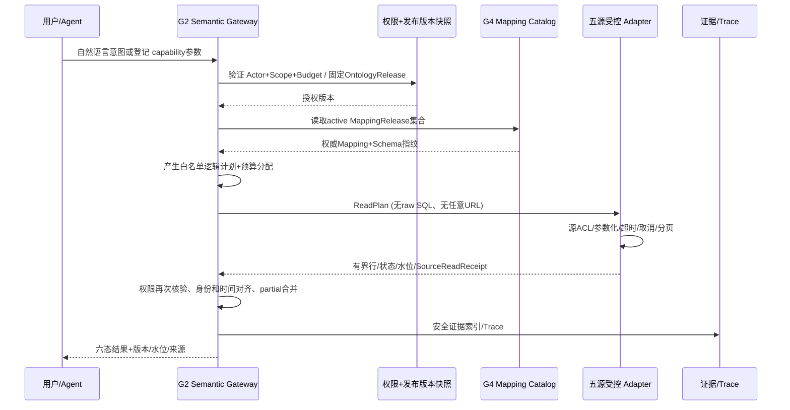

# 06 · G4 安全、受控查询、分布式执行与证据合同 V1.1

> **PROPOSED，所有运行能力仍需实现与真实验收。** 不在 G4 新开一个通用 SQL 执行器，不将用户输入透传至源，不能以 UI 隐藏按钮作为后端安全。

## 1. 权限与数据安全模型

- **身份**：服务端 Keycloak/OIDC 已验证 Claims → `ActorContext`，组织/站点非空完整 Scope；客户端 `siteIds` 只是缩小查询，不能扩大服务端 scope。
- **授权交集**：查询合法范围 = 当前 Actor 授权 ∩ SourceConnection.scope ∩ MappingRelease.scope ∩ SourceDataset 授权 ∩ SourceField 敏感权限 ∩ 查询时间窗。未通过时拒绝或在明确可切分时 PARTIAL，**不能跨厂流出无权的实体候选**。
- **最小源权限**：每个连接使用独立只读用户、表/视图显式 grant、源端网络ACL、防写账号策略。PG/Oracle/Doris/TDengine 差异按精确版本验证；不能把 `SELECT` 开头、`EXPLAIN`、函数调用当作无副作用保证。源端权限是真正最终防线，适配器在前道拒绝 DDL/DML/存储过程/管理接口。
- **凭证**：G4 **唯一**顶层 `secretRef`（与服务端 `secretVersion`）关联经审批的 Secret 管理方式；TDengine profile 不另设 credentialRef，Web API authentication=NONE 使用 null；Web/API 不返回密钥，前端不显示旧值，Review ZIP/日志不包含 SQL、token、连接串、Row 原文。环境可用性/认证失败消息可对管理员提供脱敏诊断，不对业务员泄露主机或 schema。轮换后以前的测试绑定失效。
- **跨源**：服务端不向一个外部源发送另一个源的敏感标识，除非映射/数据策略明确批准该发送。跨源 join 默认拉取最小已授权投影到受控内存，在内部完成有界映射与 join，严禁未经授权的 remote join pushdown。
- **保留与导出**：G4 Query results 默认不持久化全量行，Run 只存必要的脱敏结果快照/证据摘要/版本；审计日志只存安全 metadata；导出要再授权并受行数/次数/敏感字段策略约束。历史 Run 查看必须按当前 ACL 重新校验。
- **AI 数据外联**：Schema 名、列名及字段语义可能泄漏内部业务结构。默认仅本地规则/安全推断，任何发外部 LLM 的元数据、样本或用户查询须先走组织/厂区外联策略；用户 API Key 不能由前端或不可信提示词读取。模型生成的SQL/HTTP计划只能作为草稿表达，最终必须由确定性计划编译器严格验证。

## 2. Web API SSRF 安全合同

`UrlPolicy` 检查**scheme、Host、port、userinfo、fragment、path、query keys、DNS解析的A/AAAA实际目标IP、DNS重绑定、HTTP redirect、代理配置、跨请求连接复用及 IPv4/IPv6 映射**。允许内网访问必须由管理员为某个组织指定 IP/CIDR、origin 和服务身份同时审批，不以 `*.company.local` 这种泛泛域名放行；连接只能建立在当次已校验的地址上，并保留 TLS SNI/Host/证书核验。重试及分页 next link 重新走同一链路；OAuth token endpoint 则独立授权目标；禁止使用 `/rest/login/<username>/<password>` 一类含凭证URL。响应长度、JSON深度、压缩比及数组上限硬限制。**SSR F 负例**：localhost、IMDS、link-local、loopback、dns rebind、302跳私网、`@` userinfo、IPv6、恶意代理、URL编码/大小写/Unicode域名、`file://`、一份恶意 remote `$ref` OpenAPI。

OWASP 建议允许清单、DNS/IP 绑定、控制重定向和避免 TOCTOU；具体实现要由真实网络隔离测试验证，不把字符串正则当完整防护。

## 3. 数据源 read-only 的三层核验
| 层次 | 应满足 | 反例 |
|---|---|---|
| L1 源数据库/账户 | 只读角色、仅许可对象与范围；必要时证书/防火墙 | 即使发送插入请求也无权限，但生产环境禁止实际尝试写入 |
| L2 G4 计划编译器 | 仅允许 SchemaSnapshot 上登记的对象/字段/操作，类型化树和有界表达式，禁止用户SQL | `SELECT dangerous_function()`、`WITH`+write、COPY、任意函数、多语句、动态对象名、存储过程 |
| L3 Adapter执行 | 参数化值、标识符按注册表安全引用、query timeout+ cancellation、分页+字节/行限 | 超时仍占连接、分页无限循环、排序不稳定、跨厂数据溢出 |

G4 不是通用 ETL/CDC 写回工具；不做数据库结构变更、实时订阅推送、时序数据全量搬运。`Test Connection` 的成功应包括 readonly permissions 的**非破坏性证明**（账户 grants、测试用例、计划编译器拒绝等），而不是让生产库执行危险命令。

## 4. Schema discovery 与 Query Executor 不共用预算
建议 G4-00 冻结为两个独立默认预算草案，后续按真实 PoC 调整并记录版本：

| 项 | Schema/Probe（后台 job） | 交互语义查询（G2 兼容） |
|---|---|---|
| 单次连接建立 | 建议上限 3s（可在内部配置中合法调整） | 受现有 Gateway budget 分配 |
| 数据库对象扫描 | 建议 10s / 有界对象数、最大元数据bytes；后台超时有明确 partial | 查询时不得无授权触发全库 Schema 扫描 |
| 用户查询 plan | 不提供任意执行 | **沿用 G2 `maxRows≤100`、`timeoutMs≤5000`、depth≤5，Run整体≤30s、最多3工具调用的现有合同**，若需扩大需独立版本化审批 |
| 单个子源 limit | 非必要不读取业务样本；采样须批准 | 由 Gateway 分配最大 rows/bytes/time；source 自动调整 budget 不能越过总限额 |
| 分页与水位 | Catalog 分页与 snapshot 绑定 | 必须 stable sort、cursor/version 或明确 `INDETERMINATE_CURSOR`，跨源不承诺源系统 snapshot isolation |
| 取消 | 扫描job持久化，取消传播 | Source read cancel，不能因为断线自动重新发起同一个查询 |
| 重试 | metadata transient 失败有界且幂等；认证错误不重试 | 只重试幂等、同一次计划下同版本源、总预算内最多建议 1 次（待实测） |

**注意**：现有 G2 `timeoutMs≤5000` 不能被 G4 的新建议 10s/15s 盲覆盖；若未来交互查询确有需要，要先提出 Gateway 版本化合同、测试旧 Run/MCP 兼容。数值是建议而非实际验收数据。

## 5. 语义计划→五源读取流程

**计划缓存键**：`actor-independent semantic shape + capabilityVersion + OntologyRelease + MappingReleaseSet + SourceSchemaFingerprint + policyVersion`，绝不能以缓存绕开每次 actor authorization。源实际数据缓存如需实现，必须把组织/厂区/数据权限版本、当前撤权与 TTL 纳入缓存检查，不持久化跨组织共享实际行。首期**不做**全量数据缓存或 ETL 镜像。

## 6. 跨源查询的逻辑规则与反例

业务结果仅复用原有统一六态：`FOUND / EMPTY / PARTIAL / UNAVAILABLE / UNAUTHORIZED / AMBIGUOUS`。不新增与 Gateway 冲突的第七种结果，取消和运行中作为执行进度单独呈现。
- 主体外部 ID 不能作为全平台主键；映射必须显式保留 `organization/site/sourceNamespace/externalId/effective time`，先 resolve entity 再 traverse，歧义返回 AMBIGUOUS。
- Join 必须是已批准的 RelationBinding，允许多对多并显示 cardinality，不以 SQL 行重复数当业务关系数。不得形成 `N×M` 无上限内存 Join；在 bounded hash join 前估算 cardinality，超预算先拒绝/分页/部分返回，不能先读无限行再截断。
- 生产数据水位应按源分别记录，PG/Oracle事务快照、Doris MPP一致性、TDengine时间窗、API cursor 不能暗示同一时刻一致。结果语义 `SourceReadReceipt.watermarkKind` 每源声明 `TRANSACTION_SNAPSHOT/EVENT_TIME/OBSERVED_AT/OPAQUE/UNKNOWN`；未知不填造假值。
- Missing vs NULL vs ZERO 必须独立；Decimal 保留精度与scale；时间有效区间遵循已冻结 G3-M4 的半开语义 `[from,to)`；时区未知不能被强行 UTC 化，TDengine 纳秒等精度不能截断成毫秒并宣称完整。
- 若 3 源中1源成功返回数据、1源超时、1源权限拒绝，能合法返回的子结果须经过 ACL；若必需源失败，整体 PARTIAL（满足可信子结果）或 UNAVAILABLE（无可信结果）。不把权限拒绝隐式当缺失导致的 EMPTY。
- 若源数据变化/MappingRelease不匹配，不能用前一次计划缓存继续执行，必须明确 STALE/REVALIDATION_REQUIRED 并引导用户重试。

## 7. SourceEvidence 与安全补充
读后证据精度级别可分 `RECORD/ROW_KEY/DATASET/TIME_WINDOW/UNKNOWN`；提供可验证的源 objectRef/recordKeyHash（原始主键如敏感则脱敏）、取得数据时间/版本和合法字段摘要；无来源则标 `UNKNOWN` 并限制供 Agent 作确定事实的资格。G4 Evidence 由实际源 Adapter/Mapping 构造，不能复用 G3 的 synthetic `EvidenceService` 并冒充真业务源。证据读取每次重新做 Actor 权限检查，不能靠历史 Run 里存了合法 evidenceRef 就自由检索。

## 8. 日志与运维可观测性
标准日志仅允许 `TraceId/RunId/ConnectionId公用ID/AdapterKind/Status/Duration/RowCount/Limit/PermissionOutcome/RedactedErrorCode`；严禁 SQL正文、明文URL凭证、响应数据、SecretRef 明文可推回值。固定低基数 OTel 标签；高基数 source object ID 不进入 Prometheus 标签（可以进入受权限追踪）。失败诊断按 `DNS/TLS/AUTH/ACL/SCHEMA/QUERY/BUDGET/TIMEOUT/CANCELLED`，在 UI 提供不泄密的下一动作。源离线检测避免昂贵 ping 洪泛。

## 9. Docker Compose / 跨平台与资源收尾
- 最终项目一键部署目标 `docker compose up -d --wait`，Compose 定义 API、Web、Postgres、Keycloak、Jena/Fuseki、RustFS 等基础及按需 profile；G4 数据源用真实受控测试容器或独立远端隔离源。**本次 G4-00 只写设计，不新增Compose文件/拉镜像**。
- macOS Apple Silicon `linux/arm64` 与 Windows Docker Desktop/WSL2 `linux/amd64` 按容器平台判定，不把 Windows host wheel 当 Linux；Oracle 测试数据库镜像可能存在特定平台/许可约束，必须实测后另批，不以 QEMU 性能替代原生。
- `ComposeProjectName` 必须任务特定、唯一，记录 TaskId/RunId/实际Docker后端/对象标签/精确ID/创建命令/可再生性；默认先DryRun精准候选再Apply，不对其他项目/旧G2/G3数据卷使用全局prune、`down -v` 或删除未归属资源。
- 本任务 Codex 合同阶段不创建容器，仍需在实际 Codex 任务运行时记录 Before/After 或显式 `NOT_RUN`；不把 Docker 不可用的环境写为 PASS。

## 10. 验证最低攻击面
`T-AUTH` 未授权连接和字段；`T-ORG` 跨厂同号；`T-SQL` SQL函数/CTE/multi-statement/DDL/DML；`T-WEB` SSRF/redirect/DNS rebinding; `T-API` 429/分页循环/截断 JSON；`T-TIME` 时区/毫秒-纳秒/半开边界；`T-IDENTITY` 历史编码与多对多；`T-DRIFT` 删列类型改变；`T-SOURCE` 超时/重试/取消；`T-PUB` mapping CAS/自批/过期/回滚；`T-SECRET` 密钥与敏感数据泄露；`T-RESOURCE` Docker 未归属拒绝清理。必须有实际负例，不以 `assert code contains pattern` 代替可观察执行拒绝。

## G4-00 V1.1 查询证据及版本边界纠偏

- G2 冻结 `SemanticQueryResult` 保留原 DTO、`/api/v1/semantic/queries` 及 `EvidenceRef`（G3 发布命名图）含义。G4 源读取结果新建 `G4QueryResultV1` 并只在 `/api/v1/data/semantic-queries` 输出；`snapshot` 与 `evidence` 是版本化 G4 类型，不得假装被 G2 严格解码器接收。
- 每个候选必须带当前 Actor 可访问的 `entityIri/entityTypeIris/externalId/org/site/evidenceIds`；AMBIGUOUS 不得返回空候选，不能自动把同号跨厂合成一个实体。
- G4 证据绑定 `SourceReadReceipt`、源 Catalog 版本和 MappingRelease，记录可核实的读取时间和业务有效时间；缺主键时 `sourceRecordRef=null` 且 precision 降级。证据回源访问按当前权限复核，历史快照不能绕过 ACL。
- 连接创建不接受普通 JSON 明文密码；专用凭据通道只返回受控短期 SecretRef，再由 `POST /connections` 以唯一引用绑定；无认证 Web API 必须为 null。
- JSON Schema 只检查静态字段与局部状态约束，服务端必须进一步检查 `candidates[].evidenceIds` 可解引用、证据组织厂区授权、有效期/时间单位、实际源权限及 G2-G4 兼容拒绝。
