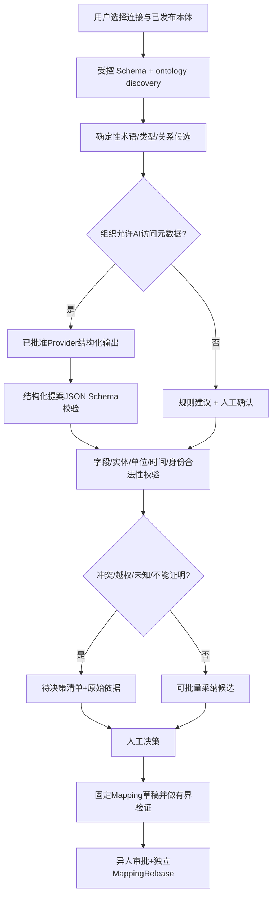

# 07 · G4 AI Native 语义对齐、用户审核与反馈合同

## 1. 为什么 G4 不是普通 ETL
G4 的目标不是把五源数据复制进新库；它要形成可版本治理的“业务语义访问能力”，让用户不需要知道表名、SQL、内部API路径，就能依据本体完成实体定位与来源可追溯的查询。AI 的最强价值在**理解 schema、发现候选映射、识别术语/单位/身份疑点、解释变更影响和降低审核工作量**，不是负责决定权限或直接执行用户随意生成的 SQL。

## 2. Context Pack：AI 所需的最小上下文
```text
ContextPack G4-01 (每次构建、执行临时读取，不另做本体元数据权威)
 ├── userIntent        领域目标和当前允许的任务
 ├── ontologySnapshot 已授权已发布本体IRI/类/属性/关系/术语/规范/版本Hash
 ├── schemaSnapshot   已授权元数据：objectRef/列名/类型/注释/键/变更Hash
 ├── sourceProfile    类型、时序特点、可见的能力、精度/单位证据
 ├── identityPolicy   G3-M4组织/厂区/源命名空间/有效期约束
 ├── changeImpact     已知Mapping/Query依赖及不可判断范围
 ├── queryBudget      最大行/深度/时间/受限字段/网络外联策略
 └── taskPolicy       是否允许模型调用、Provider/预算和敏感信息级别
```

`ContextPack` 不是每次把整套本体全量塞入 prompt。先用确定性受限能力检索相关 Class/SKOS 和 schema 对象，再按 token/字节预算构造最小片段，绑定完整快照哈希。没有外部模型许可时只进入规则建议模式，仍能正常完成手动映射。

## 3. 自动建议流水线与确定性门禁


- AI 只生成严格白名单 JSON proposal：目标Class/property的IRI必须出自当前可见 G3 Release，数据字段必须来自源 snapshot；不能创造现存表、sourceId、证据、授权厂区或事实。
- 标签/列名与 Class 相似不等于语义相同，AI 需要解释证据（术语、描述、类型、业务路径），并标注 `evidenceLevel`（`METADATA/TERM/USER_ASSERTION/NO_EVIDENCE`）。没有真实样本的映射建议必须是 `CANDIDATE_ONLY`。
- 推荐映射必须有**异人审核**进入正式 MappingRelease；验证为 BLOCKED 不能靠增加“确认通过”按钮继续。模型 token 预算/数据外联必须由策略控制，不能因外部 Provider故障换另一家并自动外传 schema。
- 不用模型自报置信度阈值决定自动发布。后台可通过确定性类型匹配、受控字段白名单、小规模语料人工标注得分为候选排序；结果仍有审核责任与证据。
- 不允许模型以工具调用形式绕开现有 Gateway 直接连生产源。Prompt-injection 文本来自字段注释/API description/网页内容时按不可信数据处理，不授予系统指令优先级。

## 4. 映射建议示例（完全合成，不表示真实工厂结构）

**输入**：已发布本体有 `Heat`、`SteelGrade`、`ConverterTapEvent`、`LfEntryEvent`、`TemperatureObservation`，源端某视图字段 `heat_no`, `plant_code`, `tap_temp`, `tap_ts`, `grade_code`，另一源为 `ts`, `temperature`, `device_tag`。

**可确定候选**：`heat_no` 应当进入外部ID候选，`grade_code` 可能对应SteelGrade的notation，`tap_ts` 可能是事件时间；必须核实 sourceNamespace、组织厂区 `plant_code`，尚不能认定 `tap_temp` 的单位、测温事件位置和 `device_tag` 对应的确切设备。

**AI应给出的问题**：
1. 两厂均有炉次 `001`，是否按厂区/源系统作为不同身份？**系统默认拒绝合并**，先要求检查现有 IdentityClaim 与厂区映射。
2. `tap_temp=1637` 未带单位。AI 可以建议“摄氏度”，但**必须通过业务来源文档、元数据或人工确认**，不能把猜测写入正式映射。
3. 另一源的 `temperature` 每秒采样，一炉有数千条。G4 可查询时间窗口并返回原始观测；**该温降指标如何定义（最后点、平均、事件点、异常剔除）属于 G5**，不能在 G4 默默替用户固定业务口径。
4. `tap_ts` 为无时区时间，系统应要求业务 timezone policy 并保存，不得直接把当前服务器时区视为工厂时区。

**正常的 AI 输出**：带证据的 `MappingSuggestion`，列出 `MATCHED/PROPOSED/NEEDS_REVIEW/BLOCKED`，用户看到的是中文描述和可选决策，不需要直接编辑 Turtle。正式本体不存在的概念形成 G3 扩展提案链接，而不是在映射保存时插入新的 `owl:Class`。

## 5. AI 辅助用户决策的交互设计
AI 工作台每次运行输出一份“执行摘要”：关联多少已授权对象，推荐多少字段，多少条可确定，多少条不确定，导致无法发布的错误有哪些；高风险问题优先置顶。对于重复名称、未知单位、时间范围冲突，用户打开问题卡看到：`证据来源`、`当前G3术语定义`、`AI建议原因`、`可选动作（接受/修正/拒绝/暂缓）`、`影响的Mapping/查询`。审阅后只重新校验受影响部分；不每次全量重新跑 AI。与审核分离，普通专家的“采纳建议”不等于正式发布。

## 6. 三种 AI 模式与成本控制
- `OFF`：无模型，术语/正则/类型/Schema 规则推荐，用户可自行完成编辑、校验与发布。
- `LOCAL`：管理员配置的 Ollama/私有模型，需实际 CapabilityProbe/schema输出一致性验证；不得默认未知的local模型自动部署。
- `APPROVED_EXTERNAL`：OpenAI、DeepSeek、Qwen、GLM、Kimi 已通过 Model Gateway 与组织外联策略的模型。凭证由 SecretRef，最小数据和预算；API 费用、模型名称/兼容性/重试行为必须在另行授权的真实模型任务中验证。G4-00 不运行任何模型，所有结果为 `NOT_RUN`。

**默认：OFF + 可用的确定性建议**；只有组织已明确设置模型策略才执行自动 AI 对齐，且 UI显示“AI建议而非确认事实”。任何模型输出内容不能作为数据库查询计划或授权命令直接执行。

## 7. ASDM 借鉴的工程思想（只做方法转译）
- **Context Engineering**：建立最小、版本绑定的 Ontology+Schema+Policy Context Pack；不是把整个数据库DDL和所有文件一次送入模型。
- **Harness Engineering**：候选经过机器校验、负例、版本/预算/权限守卫，再由人审，不依赖 LLM“相信自己已验证”。
- **Self-Iteration**：把每次映射审核拒绝原因、Schema drift 修复、真实 Query Eval 归档为可重放样本，形成“下次推荐更准确”的反馈；**不自动改正式Ontology或映射规则**。

## 8. 可度量 AI Native 成效（候选试验门槛，待真实样本冻结）
| 指标 | 建议观察方法 | 决定 |
|---|---|---|
| 人工配置步骤 | 首次接入/二次接入每步骤成功、平均人工输入数 | AI对照和无模型对照，不能单凭页面数判断 |
| 推荐字段准确率 | 双专家 Gold 的 Precision/Recall/F1，按源/字段类型拆分 | 质量门槛随真实 Gold 批准冻结 |
| 冲突识别率 | 组织同号、未知单位、时区/字段漂移反例 | 高风险漏检不能靠平均 F1 隐藏 |
| 单连接接入耗时 | 保存→测试→Catalog→提案→审核完成的 wall time与人时 | 性能和人工时间分开统计 |
| 模型费用及泄露 | 每次Provider调用次数、token/元数据分类/数据外联审计 | 费用越限拒绝、敏感外联负例0泄露 |
| 映射生效率 | 已批准Mapping在真实 Query返回可追溯且符合权限数据的比例 | 只看模型生成JSON不是验收 |

## 9. G4→G7 Agent 接口边界
G4 只注册经审的 `describe_source_capabilities`、`resolve_entity_with_mapping`、`query_mapped_observations` 等候选，只读且有明确 schema/预算。注册前需核对 G2 白名单现有3个工具的兼容与版本治理，不默认全部自动暴露给外部 MCP。对用户查询，Agent 只能请求合法已注册能力，不能自行生成 SQL、放大厂区/行数和跳过审批。G7 解释时区分 `测量实证`（G4）/`确定性指标规则`（G5）/`文档经验`（G6）/`Agent 推测`（G7），并附各自证据。
