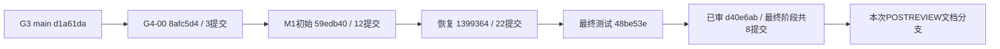

# 完整逐提交资格审查与依赖图

状态：预检范围资格映射完成；main集成NOT_AUTHORIZED。当前观察45项不是永久常量。

所有父链连续，无G3新增提交，无G6路径；main→旧Head 588个变更路径，详细状态逐项见integration-path-inventory.json。main是祖先，merge-base=d1a61da，left/right=0/45。完整SHA/parent/每文件状态/patch-id/diff哈希见commit-inventory.json。

授权映射来自各任务原直接授权，G4-00见其任务卡；独立Review引用读取自d40e6ab快照，精确blob见input-review.json。Review通常覆盖批量终态，不声称每个中间提交都曾独立产品通过。M1初始和恢复的BLOCKED由最终C08/R04精确补证关闭，原记录保持。所有提交仍需新的main审批；没有将“未批准main”误记为原实现越权。

|序|完整SHA / 标题|任务及授权/Review|逐项范围与风险裁决|集成资格|
|---|---|---|---|---|
|1|`7132c51203939d9b47de047d5c187f339910ba26` docs(g4): archive reviewed five-source contracts and design evidence (PARTIAL)|G4-00-CONTRACT-001；授权 `docs/tasks/G4-00-CONTRACT-001.md`；Review `docs/evidence/G4-00-CONTRACT-001/review-receipt.json`|五源PROPOSED合同与设计样例；无产品启用许可；P1_MAIN_APPROVAL_PENDING|候选，main未授权|
|2|`a919d624ef85fdc5c1ff75c404052ec427296295` docs(g4): preserve original input bytes and close final format gate|G4-00-CONTRACT-001；授权 `docs/tasks/G4-00-CONTRACT-001.md`；Review `docs/evidence/G4-00-CONTRACT-001/review-receipt.json`|EOF规范化和原输入字节恢复；不是设计批准升级；P1_MAIN_APPROVAL_PENDING, P2_EVIDENCE_EVOLUTION_PRESERVE_HISTORY|候选，main未授权|
|3|`8afc5d4dfd32e7adb48262cce6587057c0e68715` docs(g4): bind local contract validation to reviewed commit|G4-00-CONTRACT-001；授权 `docs/tasks/G4-00-CONTRACT-001.md`；Review `docs/evidence/G4-00-CONTRACT-001/review-receipt.json`|设计本地验证绑定，产品NOT_RUN；P1_MAIN_APPROVAL_PENDING, P2_EVIDENCE_EVOLUTION_PRESERVE_HISTORY|候选，main未授权|
|4|`ceadd5393a377e537539c29d144ddd59ce51d103` feat(g4): freeze reviewed M1 connection contracts and dispatch gates (PARTIAL)|G4-M1-CONNECTION-001；授权 `docs/evidence/G4-M1-CONNECTION-001/authorization.md`；Review `docs/evidence/G4-M1-CONNECTION-001/independent-component-review.md`|M1五类DTO/PG SPI/严格wire及E0入口；公共单写授权；P1_MAIN_APPROVAL_PENDING, P2_SHARED_INPUT_REGRESSION|候选，main未授权|
|5|`719aaca36ca6988f28e7daf71725f92684ae7e87` build(g4): add owned connection adapter test project (PARTIAL)|G4-M1-CONNECTION-001；授权 `docs/evidence/G4-M1-CONNECTION-001/authorization.md`；Review `docs/evidence/G4-M1-CONNECTION-001/independent-component-review.md`|Connections测试项目和solution图；无新驱动选择；P1_MAIN_APPROVAL_PENDING, P2_SHARED_INPUT_REGRESSION|候选，main未授权|
|6|`18cd1f7b89286af354f844c8f4b253fcc659f517` feat(g4): export native API contracts and isolate metadata storage (PARTIAL)|G4-M1-CONNECTION-001；授权 `docs/evidence/G4-M1-CONNECTION-001/authorization.md`；Review `docs/evidence/G4-M1-CONNECTION-001/independent-component-review.md`|G4原生OpenAPI、Connections存储/生成链；需共享输入回归；P1_MAIN_APPROVAL_PENDING, P2_SHARED_INPUT_REGRESSION|候选，main未授权|
|7|`1dbf66ae1114c83fe4894f51c46496f4654a1f2d` feat(g4): implement bounded read-only PostgreSQL source adapter (PARTIAL)|G4-M1-CONNECTION-001；授权 `docs/evidence/G4-M1-CONNECTION-001/authorization.md`；Review `docs/evidence/G4-M1-CONNECTION-001/independent-component-review.md`|PG固定SQL/只读Adapter与负例；原组件Review范围；P1_MAIN_APPROVAL_PENDING|候选，main未授权|
|8|`de9bbe5f2b273eb3c404cdce445c5e225032f2d4` fix(g4): freeze schema query scope across async source calls|G4-M1-CONNECTION-001；授权 `docs/evidence/G4-M1-CONNECTION-001/authorization.md`；Review `docs/evidence/G4-M1-CONNECTION-001/independent-component-review.md`|异步schema数组快照防外部扩权；PG审查修订；P1_MAIN_APPROVAL_PENDING|候选，main未授权|
|9|`79610f79c0b4e710e8c6e25097e94b4b7504f654` feat(web): add connection lifecycle UI slice (DRAFT)|G4-M1-CONNECTION-001；授权 `docs/evidence/G4-M1-CONNECTION-001/authorization.md`；Review `docs/evidence/G4-M1-CONNECTION-001/independent-component-review.md`|中文连接UI及五类表单；非PG不伪成功；P1_MAIN_APPROVAL_PENDING|候选，main未授权|
|10|`607b7d1ae780ba52ba74be4940f012497e6211f4` fix(web): preserve safe connection drafts and stale recovery|G4-M1-CONNECTION-001；授权 `docs/evidence/G4-M1-CONNECTION-001/authorization.md`；Review `docs/evidence/G4-M1-CONNECTION-001/independent-component-review.md`|草稿持久化/过期恢复，须结合后续凭据清理修订；P1_MAIN_APPROVAL_PENDING|候选，main未授权|
|11|`2c2b2804d3c39e5973d7151a0c305d9c60c90d0f` fix(web): clear obsolete probe display and guard draft credentials|G4-M1-CONNECTION-001；授权 `docs/evidence/G4-M1-CONNECTION-001/authorization.md`；Review `docs/evidence/G4-M1-CONNECTION-001/independent-component-review.md`|旧Probe清理与缓存凭据防护，不能独立部署该中间态；P1_MAIN_APPROVAL_PENDING|候选，main未授权|
|12|`f31767117a9b99879c973a1f6be31ed6697396ae` fix(web): align source diagnostics and reject credential-bearing drafts|G4-M1-CONNECTION-001；授权 `docs/evidence/G4-M1-CONNECTION-001/authorization.md`；Review `docs/evidence/G4-M1-CONNECTION-001/independent-component-review.md`|诊断码映射及userinfo拒绝；后续query修订依赖；P1_MAIN_APPROVAL_PENDING|候选，main未授权|
|13|`ee6fb15942ed849845c8a9e8d8524d22fb64086c` fix(web): keep parameterized connection URLs out of draft cache|G4-M1-CONNECTION-001；授权 `docs/evidence/G4-M1-CONNECTION-001/authorization.md`；Review `docs/evidence/G4-M1-CONNECTION-001/independent-component-review.md`|query/fragment/userinfo全面拒绝缓存；对应UI审查终态；P1_MAIN_APPROVAL_PENDING|候选，main未授权|
|14|`958dc6c4eb121958ae889213d1a523a7e7914ce8` feat(connections): persist lifecycle draft; block runtime on image license gate|G4-M1-CONNECTION-001；授权 `docs/evidence/G4-M1-CONNECTION-001/authorization.md`；Review `docs/evidence/G4-M1-CONNECTION-001/independent-component-review.md`|连接生命周期/事务审计/Session引用/迁移；共享Host回归必需；P1_MAIN_APPROVAL_PENDING, P2_SHARED_INPUT_REGRESSION|候选，main未授权|
|15|`59edb405dfb4acf4d4a259cffdc3551bafa90d2c` docs(g4-m1): bind partial tests and precise cleanup to blocked witness|G4-M1-CONNECTION-001；授权 `docs/evidence/G4-M1-CONNECTION-001/authorization.md`；Review `docs/evidence/G4-M1-CONNECTION-001/independent-component-review.md`|首次运行许可阻断真实保留；后续恢复不改原结论；P1_MAIN_APPROVAL_PENDING, P2_EVIDENCE_EVOLUTION_PRESERVE_HISTORY|候选，main未授权|
|16|`840155b9ca707ecb8208c6ee57dead14b014a03d` test(g4): reproduce streamed request body limit bypass|G4-M1-RECOVERY-001；授权 `docs/evidence/G4-M1-RECOVERY-001/authorization.md`；Review `docs/evidence/G4-M1-RECOVERY-001/r5-independent-review.md`|64KiB流式正文缺口红例；单独提交预期失败；P1_MAIN_APPROVAL_PENDING|候选，main未授权|
|17|`cb40815090bce36ce982b6365f50c4346776a568` fix(g4): bound streamed request bodies and admit controlled recovery forensics|G4-M1-RECOVERY-001；授权 `docs/evidence/G4-M1-RECOVERY-001/authorization.md`；Review `docs/evidence/G4-M1-RECOVERY-001/r5-independent-review.md`|流式限长修复及恢复准入；共享Host安全回归；P1_MAIN_APPROVAL_PENDING, P2_SHARED_INPUT_REGRESSION|候选，main未授权|
|18|`7527ae6bccb6f6869f4a85ac867d1feb26ec117f` test(g4): add isolated PostgreSQL TLS and ACL fixtures|G4-M1-RECOVERY-001；授权 `docs/evidence/G4-M1-RECOVERY-001/authorization.md`；Review `docs/evidence/G4-M1-RECOVERY-001/r5-independent-review.md`|隔离TLS/ACL夹具，非生产配置；P1_MAIN_APPROVAL_PENDING|候选，main未授权|
|19|`605acc98d98b9cbddae0d0ffd9227f764deea0ac` docs(g4): preserve offline Keycloak component and license evidence|G4-M1-RECOVERY-001；授权 `docs/evidence/G4-M1-RECOVERY-001/authorization.md`；Review `docs/evidence/G4-M1-RECOVERY-001/r5-independent-review.md`|Keycloak离线组件取证；不等于商业许可；P1_MAIN_APPROVAL_PENDING|候选，main未授权|
|20|`37a65f9aad5247373b86c9f842d4c61fe38bc734` test(g4): add real OIDC browser acceptance driver|G4-M1-RECOVERY-001；授权 `docs/evidence/G4-M1-RECOVERY-001/authorization.md`；Review `docs/evidence/G4-M1-RECOVERY-001/r5-independent-review.md`|浏览器验收驱动，非产品功能；P1_MAIN_APPROVAL_PENDING|候选，main未授权|
|21|`6ceb0de58aea9630c82c86afdd75022e6629adaf` test(g4): add real OIDC HTTP recovery acceptance driver|G4-M1-RECOVERY-001；授权 `docs/evidence/G4-M1-RECOVERY-001/authorization.md`；Review `docs/evidence/G4-M1-RECOVERY-001/r5-independent-review.md`|OIDC HTTP验收驱动，非伪造actor；P1_MAIN_APPROVAL_PENDING|候选，main未授权|
|22|`cdf9e0ce63c5a784f1473b7de0117ae07f4d912b` feat(g4): recover audited ARM64 synthetic runtime and real PG validation (PARTIAL)|G4-M1-RECOVERY-001；授权 `docs/evidence/G4-M1-RECOVERY-001/authorization.md`；Review `docs/evidence/G4-M1-RECOVERY-001/r5-independent-review.md`|ARM64隔离运行、目录SQL差异和镜像取证；实验入口不发布；P1_MAIN_APPROVAL_PENDING, P2_EVIDENCE_EVOLUTION_PRESERVE_HISTORY|候选，main未授权|
|23|`3e3d5bf6d2aff80f8ec6dddfcca088ff659baf62` test(g4): close acceptance connections and classify OIDC failures|G4-M1-RECOVERY-001；授权 `docs/evidence/G4-M1-RECOVERY-001/authorization.md`；Review `docs/evidence/G4-M1-RECOVERY-001/r5-independent-review.md`|验收连接关闭与OIDC错误分类，保留失败；P1_MAIN_APPROVAL_PENDING|候选，main未授权|
|24|`ee10927ff27a714733d3059a9f449c0703098daf` docs(g4): preserve raw evidence bytes with reviewable JSON envelopes|G4-M1-RECOVERY-001；授权 `docs/evidence/G4-M1-RECOVERY-001/authorization.md`；Review `docs/evidence/G4-M1-RECOVERY-001/r5-independent-review.md`|原证据包封装/EOF修正；必须用原字节恢复索引；P1_MAIN_APPROVAL_PENDING, P2_EVIDENCE_EVOLUTION_PRESERVE_HISTORY|候选，main未授权|
|25|`1fb6982ecbad4822062d0a9e56725c249dcd6ac4` fix(g4): honor canonical operator role in connection UI|G4-M1-RECOVERY-001；授权 `docs/evidence/G4-M1-RECOVERY-001/authorization.md`；Review `docs/evidence/G4-M1-RECOVERY-001/r5-independent-review.md`|前端canonical operator角色匹配；权限仍服务端；P1_MAIN_APPROVAL_PENDING|候选，main未授权|
|26|`1c9779ec8cadc71c931a89c9c5deb1369b5dc180` test(g4): verify settled viewport layout and hit targets|G4-M1-RECOVERY-001；授权 `docs/evidence/G4-M1-RECOVERY-001/authorization.md`；Review `docs/evidence/G4-M1-RECOVERY-001/r5-independent-review.md`|真实视口/命中目标验收，不更改产品；P1_MAIN_APPROVAL_PENDING|候选，main未授权|
|27|`f34a5597c6857090662288bf8711a9ef95085987` test(g4): distinguish real source timeout from connection refusal|G4-M1-RECOVERY-001；授权 `docs/evidence/G4-M1-RECOVERY-001/authorization.md`；Review `docs/evidence/G4-M1-RECOVERY-001/r5-independent-review.md`|区分拒连和超时故障，不能互相替代；P1_MAIN_APPROVAL_PENDING|候选，main未授权|
|28|`188e2b51adcdc161be7687788e7e86019d248c7e` test(g4): synchronize bounded source timeout pause handshake|G4-M1-RECOVERY-001；授权 `docs/evidence/G4-M1-RECOVERY-001/authorization.md`；Review `docs/evidence/G4-M1-RECOVERY-001/r5-independent-review.md`|源暂停握手仅验收驱动；P1_MAIN_APPROVAL_PENDING|候选，main未授权|
|29|`35631fef44a936cd31709a5974966f876d611bb3` fix(g4): retain authorized job diagnostics after catalog denial|G4-M1-RECOVERY-001；授权 `docs/evidence/G4-M1-RECOVERY-001/authorization.md`；Review `docs/evidence/G4-M1-RECOVERY-001/r5-independent-review.md`|目录权限失败后授权诊断可读；不得开放旧快照；P1_MAIN_APPROVAL_PENDING|候选，main未授权|
|30|`5703f4600b8047411d41ec758636cd546b0d811e` test(g4): cover credential rotation and actual cross-org rejection|G4-M1-RECOVERY-001；授权 `docs/evidence/G4-M1-RECOVERY-001/authorization.md`；Review `docs/evidence/G4-M1-RECOVERY-001/r5-independent-review.md`|轮换/跨组织反例驱动；P1_MAIN_APPROVAL_PENDING|候选，main未授权|
|31|`b70b142c5b002c1033e47af1580b4802ba1a3845` fix(g4): preserve snapshot freshness and distinguish real request cancellation (PARTIAL)|G4-M1-RECOVERY-001；授权 `docs/evidence/G4-M1-RECOVERY-001/authorization.md`；Review `docs/evidence/G4-M1-RECOVERY-001/r5-independent-review.md`|STALE与取消分类；审计/lease终态证据不可漏；P1_MAIN_APPROVAL_PENDING|候选，main未授权|
|32|`d0cf54ed6d42aef6cedb266a55fcaa31f55268f5` test(g4): coordinate real catalog cancellation witness|G4-M1-RECOVERY-001；授权 `docs/evidence/G4-M1-RECOVERY-001/authorization.md`；Review `docs/evidence/G4-M1-RECOVERY-001/r5-independent-review.md`|真实取消与浏览器协调，保留原失败；P1_MAIN_APPROVAL_PENDING|候选，main未授权|
|33|`9b9b39e58c2cbd968935c137e412bc2ec2ffa9f0` test(g4): isolate organization change for same credential subject|G4-M1-RECOVERY-001；授权 `docs/evidence/G4-M1-RECOVERY-001/authorization.md`；Review `docs/evidence/G4-M1-RECOVERY-001/r5-independent-review.md`|同subject跨org隔离反例；P1_MAIN_APPROVAL_PENDING|候选，main未授权|
|34|`47663df81f7b59c97a5dc2ae022b31f36cd237ad` fix(g4): stabilize OpenAPI origin and restore project graph|G4-M1-RECOVERY-001；授权 `docs/evidence/G4-M1-RECOVERY-001/authorization.md`；Review `docs/evidence/G4-M1-RECOVERY-001/r5-independent-review.md`|OpenAPI相对server及两测试项目锁图修正；无第三方版本升级；P1_MAIN_APPROVAL_PENDING, P2_SHARED_INPUT_REGRESSION, P2_EVIDENCE_EVOLUTION_PRESERVE_HISTORY|候选，main未授权|
|35|`d7f3208893edc05a336d5d6ca3d5d9df9192be51` fix(g4): serialize connection and catalog UI operations|G4-M1-RECOVERY-001；授权 `docs/evidence/G4-M1-RECOVERY-001/authorization.md`；Review `docs/evidence/G4-M1-RECOVERY-001/r5-independent-review.md`|父子UI双向互锁；109组件正反与真实pending证明；P1_MAIN_APPROVAL_PENDING|候选，main未授权|
|36|`4efbeca1cbf33d52c2bd950e1968db20abe322d5` test(g4): freeze reviewed recovery witnesses and scoped UI copy|G4-M1-RECOVERY-001；授权 `docs/evidence/G4-M1-RECOVERY-001/authorization.md`；Review `docs/evidence/G4-M1-RECOVERY-001/r5-independent-review.md`|恢复证据/资源与connections限定文案；旧模块文案保持；P1_MAIN_APPROVAL_PENDING|候选，main未授权|
|37|`1399364ad1367f3d1bfdee4d9901fdb33b48c15d` docs(g4): record blocked recovery acceptance and exact cleanup|G4-M1-RECOVERY-001；授权 `docs/evidence/G4-M1-RECOVERY-001/authorization.md`；Review `docs/evidence/G4-M1-RECOVERY-001/r5-independent-review.md`|恢复关口C08/R04阻断及准确清理真实保留；P1_MAIN_APPROVAL_PENDING, P2_EVIDENCE_EVOLUTION_PRESERVE_HISTORY|候选，main未授权|
|38|`fbe822f2a43170fb34a4542880673ac7c2d2cc54` feat(g4): close C08 exact PostgreSQL profile gate with reviewed evidence|G4-M1-FINAL-GATES-001；授权 `docs/evidence/G4-M1-FINAL-GATES-001/authorization.md`；Review `docs/evidence/G4-M1-FINAL-GATES-001/final-independent-review.md`|C08精确public合成例外、权限交集；Development守卫仍在；P1_MAIN_APPROVAL_PENDING, P2_SHARED_INPUT_REGRESSION|候选，main未授权|
|39|`e9c51d75b19e75276a7517a721e1e45cc30fb8be` docs(g4): normalize SBOM EOF with original-byte receipt|G4-M1-FINAL-GATES-001；授权 `docs/evidence/G4-M1-FINAL-GATES-001/authorization.md`；Review `docs/evidence/G4-M1-FINAL-GATES-001/final-independent-review.md`|SBOM EOF修正；原字节回执绑定；P1_MAIN_APPROVAL_PENDING, P2_EVIDENCE_EVOLUTION_PRESERVE_HISTORY|候选，main未授权|
|40|`48d53eee02eb3c545593b35dfca673b222c42eda` test(g4): preserve first R04 witness and add targeted public schema fault test|G4-M1-FINAL-GATES-001；授权 `docs/evidence/G4-M1-FINAL-GATES-001/authorization.md`；Review `docs/evidence/G4-M1-FINAL-GATES-001/final-independent-review.md`|保留首轮R04失败并补public拒绝路径；P1_MAIN_APPROVAL_PENDING|候选，main未授权|
|41|`954a2b8e8eab6bc709139eda4921633e5931958c` test(g4): prove public fault boundaries and strengthen isolated G3 version witnesses|G4-M1-FINAL-GATES-001；授权 `docs/evidence/G4-M1-FINAL-GATES-001/authorization.md`；Review `docs/evidence/G4-M1-FINAL-GATES-001/final-independent-review.md`|公共schema故障与G3版本绑定加强；实验镜像仅旧批准范围；P1_MAIN_APPROVAL_PENDING|候选，main未授权|
|42|`48be53e807cab22622ea31c6b39d6cb8805e9771` test(g4): compare stored and HTTP activation field naming accurately|G4-M1-FINAL-GATES-001；授权 `docs/evidence/G4-M1-FINAL-GATES-001/authorization.md`；Review `docs/evidence/G4-M1-FINAL-GATES-001/final-independent-review.md`|DB/HTTP字段命名校正；这是旧产品TestedCommit；P1_MAIN_APPROVAL_PENDING|候选，main未授权|
|43|`53c34a28ba3c6b0a2050219038412a42e59ddc9b` docs(g4): freeze independently passed final gates runtime witnesses|G4-M1-FINAL-GATES-001；授权 `docs/evidence/G4-M1-FINAL-GATES-001/authorization.md`；Review `docs/evidence/G4-M1-FINAL-GATES-001/final-independent-review.md`|实际运行/清理/格式原字节见证，不改旧失败为通过；P1_MAIN_APPROVAL_PENDING, P2_EVIDENCE_EVOLUTION_PRESERVE_HISTORY|候选，main未授权|
|44|`7da6363d1a891cba11318f9c9bd883033e65f1cb` docs(g4): freeze scoped acceptance matrix and approved resource closeout|G4-M1-FINAL-GATES-001；授权 `docs/evidence/G4-M1-FINAL-GATES-001/authorization.md`；Review `docs/evidence/G4-M1-FINAL-GATES-001/final-independent-review.md`|包内47PASS/2PENDING冻结与已审归档清理；P1_MAIN_APPROVAL_PENDING|候选，main未授权|
|45|`d40e6ab67360cc46aadd7ec013bd514b3f61a6ea` docs(g4): finalize reviewed local validation and delivery gate evidence|G4-M1-FINAL-GATES-001；授权 `docs/evidence/G4-M1-FINAL-GATES-001/authorization.md`；Review `docs/evidence/G4-M1-FINAL-GATES-001/final-independent-review.md`|最终本地绑定和非作者审查；包外49PASS另存不重写ZIP；P1_MAIN_APPROVAL_PENDING, P2_EVIDENCE_EVOLUTION_PRESERVE_HISTORY|MAIN_INTEGRATION_BLOCKED，R09|

## 最终验证新增阻断

逐提交第45项d40e6ab的原实施授权仍可定位，但**集成资格现为MAIN_INTEGRATION_BLOCKED_ENGINEERING_INPUT**：其新增host-monitor.json为JSONL，导致当前真实SelfTest在套件之前失败。其余44项不能绕开此阻断自动摘取集成。详细精确字节/短复现/未来最小修复候选见blocked-witness.json、risk-register.md R09及main-integration-authorization.md。原49产品事实保持继承。
