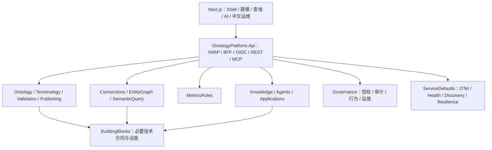
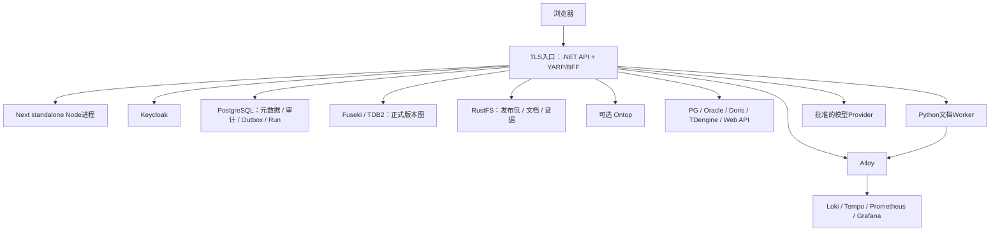
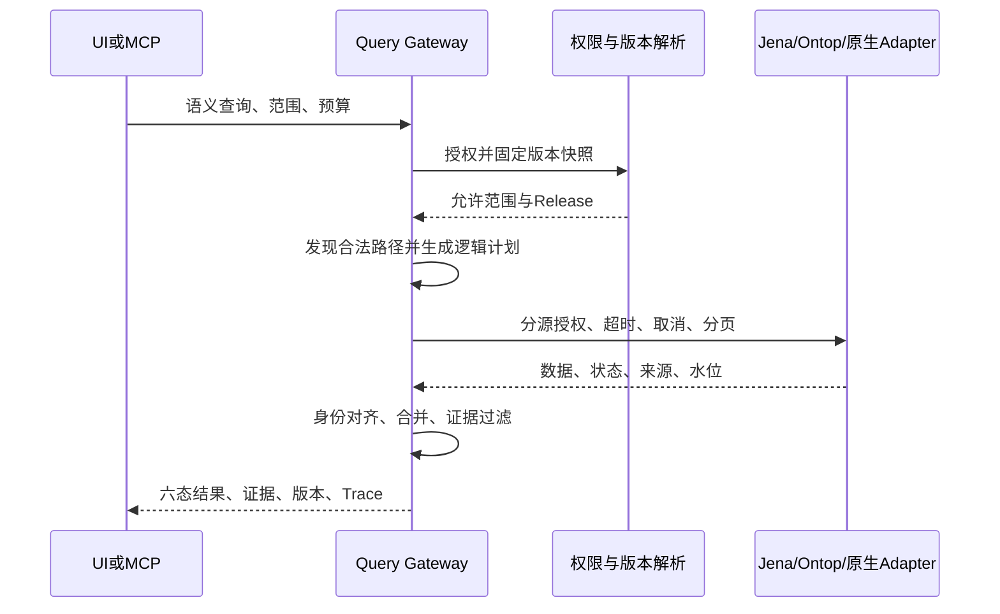
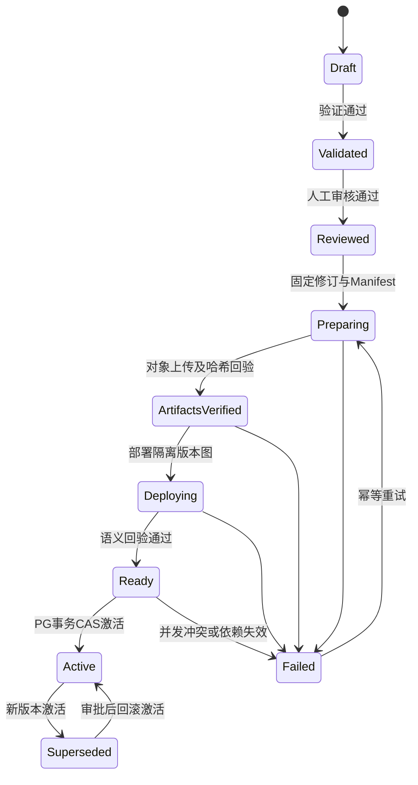
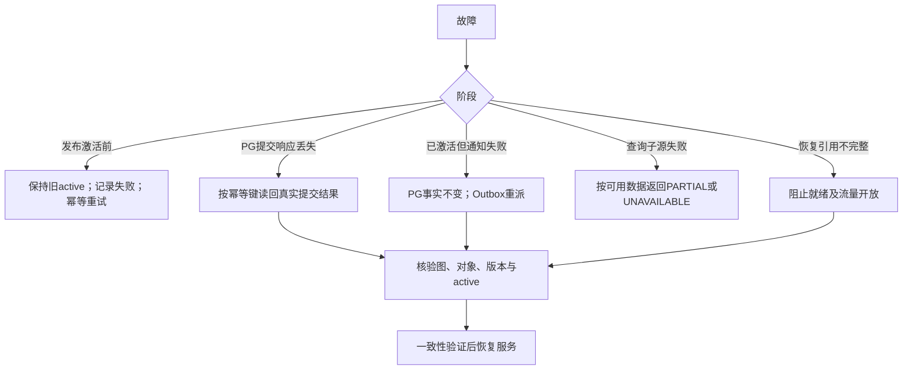
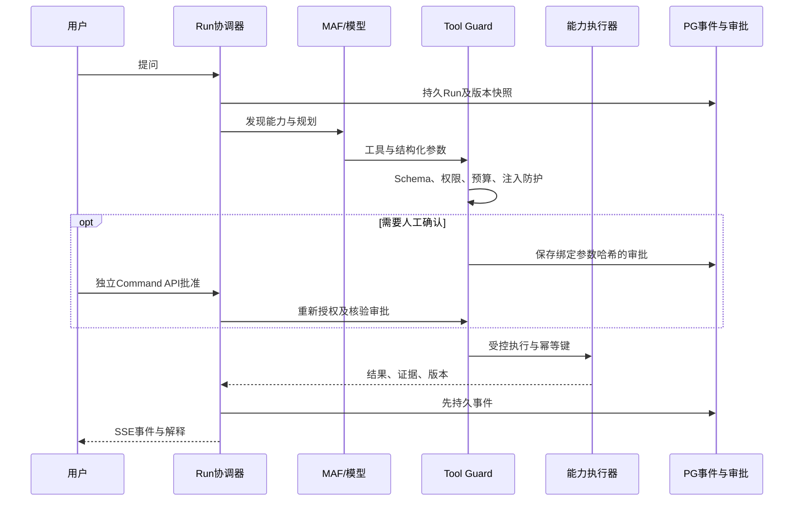
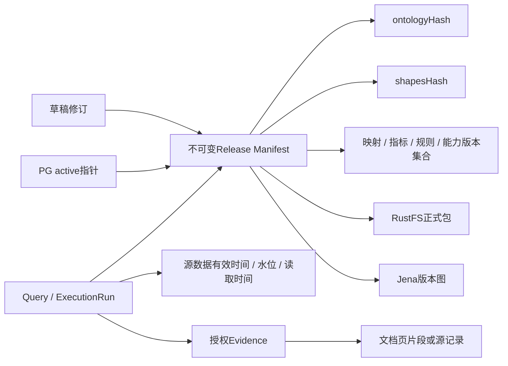

# 02 · 目标架构与公共契约

以下结构、接口和图均为 **PROPOSED**；测试均 **NOT_RUN**。G0归档不授权实现。冻结需求见 [启动合同](../bootstrap/ontology-platform-codex-master-plan-bootstrap-v1.0.md)，决策见 [01](01-decisions-and-nongoals.md)。

## 边界与项目粒度

- `OntologyPlatform.Api` 是单一ASP.NET Core部署入口，集成模块端点、YARP/BFF、授权与应用组合。
- `OntologyPlatform.AppHost` 仅描述开发资源、依赖、参数和启动顺序。
- `OntologyPlatform.ServiceDefaults` 仅包含OTel、健康检查、服务发现、HTTP弹性等宿主默认配置。
- BuildingBlocks仅承载必要跨模块技术契约和设施；禁止共享业务实体、全局DbContext、万能基类。
- 普通模块使用一个实现项目，按`Domain/Features/Infrastructure/Endpoints`组织；真实跨模块消费者出现时增加Contracts项目。
- G2的Ontology、Publishing等复杂领域采用独立Domain项目，编译期隔离EF、HTTP、Jena和LLM SDK；其他模块先由架构测试约束，避免机械复制多层空项目。
- 每模块独有DbContext、PG schema、迁移和写入API；跨模块通过合同或集成事件协作。
- Jena/Ontop/文档Worker是专业进程；MAF是产品运行时能力，不承担研发团队编排。

## 公共接口

统一前缀`/api/v1`；REST、MCP和UI调用同一应用服务。

| 接口族 | 主要接口/职责 |
|---|---|
| 本体治理 | `/ontology-drafts`、`/validations`、`/release-proposals`、`/releases`、`/release-activations` |
| 数据绑定 | `/connections`、`/schema-discoveries`、`/mappings`、`/mapping-tests`、`/identity-conflicts` |
| 语义查询 | `/semantic/discover`、`/semantic/queries` |
| 指标规则 | `/metrics`、`/metric-evaluations`、`/rules`、`/rule-evaluations` |
| 文档候选 | `/documents`、`/document-jobs`、`/extraction-proposals`、`/proposal-decisions` |
| 能力与运行 | `/capabilities`、`/capability-invocations`、`/execution-runs`、运行事件与取消接口 |
| 人工审批 | `/approvals/{id}/decisions`，独立命令，不通过SSE提交 |
| 治理运维 | 资源授权、审计、行为事件、健康、任务和执行诊断接口 |

G1冻结以下公共DTO，作为后续契约测试输入（本轮不创建合同源码）：

- `CommandContext`：命令ID、幂等键、预期修订、操作理由；操作者及权限范围从认证上下文取得。
- `EvidenceRef`：来源定位、内容哈希、文档页/片段或记录引用、有效时间、采集时间、权限范围。
- `AssetVersionSnapshot`：Release ID、ontology/shapes hash，以及映射、指标、规则、能力的**资产ID—版本集合**。
- `SemanticQueryResult`：`FOUND/EMPTY/PARTIAL/UNAVAILABLE/UNAUTHORIZED/AMBIGUOUS`、数据、子源状态、证据、版本和数据时效。
- `ExecutionRun/Event`：运行ID、单调序号、事件类型、Schema版本、时间和载荷。
- 系统错误使用ProblemDetails，附业务错误码、Trace ID、是否可重试。

数据有效时间、读取时间、水位与资产版本分开。一次查询/运行固定资产快照；无法获得跨源一致快照时明确标注一致性能力。所有操作按资源、组织厂区和源权限检查；证据读取再次授权。

## 七类可编辑架构图

### 1. 逻辑架构

### 2. 物理部署候选

开发环境由AppHost编排。生产HA拓扑需经G8验证，不能从此图推断TDB2可共享目录多写。

### 3. 查询时序

### 4. 发布状态机

### 5. 跨存储及跨源故障恢复

### 6. Agent工具调用时序

### 7. 数据与版本关系

## 一致性与可靠运行

发布采用不可变外部制品和PG权威指针。上传、部署、回验全部完成后，PG在同一事务内CAS更新active、审计和Outbox。任何激活前失败均保留旧active；提交响应丢失时读回事实。缓存按Release ID寻址，不依靠通知失效保障正确性。

回滚是重新激活完整旧版本，保留运行引用和保留期内的图与对象。备份清单覆盖PG/WAL、Manifest、Jena和RustFS；隔离恢复后验证引用完整性才开放流量。

ExecutionRun使用PG持久状态、事件、租约和fencing token。SSE事件先存后发，以序号作为事件ID；支持Last-Event-ID重放和客户端去重。过期游标明确失败并提供运行快照。网络断开不等于取消；显式取消持久化并传播取消信号。

审批绑定提案修订、参数哈希、资源范围和有效期；执行前重新授权。MAF Checkpoint与Run状态的一致性列为专项PoC，不预先宣称同事务或恰好一次执行。
