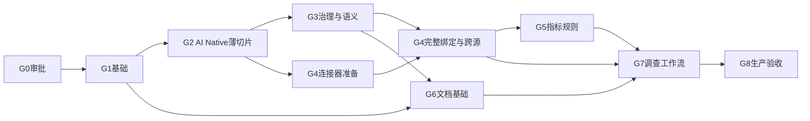

# 04 · 路线、依赖与阶段门禁

全部实施安排为 **PROPOSED**、测试为 **NOT_RUN**。本次仅批准G0归档，G1–G8尚未授权。G1首个执行任务固定为 [G1-ENG-001](05-agent-team-and-task-contracts.md#g1-eng-001-首个执行任务计划入口)，只有收到下一轮专用G1授权后才能执行。

| 关口 | 可审查交付与退出标准 |
|---|---|
| G0 | 本计划、事实证据、ADR提案和未验证清单；总体通过，仅文档固化获准，不自动进入实施 |
| G1 | 固定工具链、真实登录和拒绝、Shell、API/OpenAPI、模块边界、PG审计/Outbox、Jena/RustFS开发资源、OTel与中文入口、CI；一键启动及基础安全闭环通过 |
| G2 | 极小本体、SHACL、人工批准、不可变发布、Jena查询、受控MCP、最小模型调用、持久SSE、证据、回滚；真实AI Native闭环通过 |
| G3 | 二十项能力支持表、标准导入导出、身份/时间、SKOS、Diff、影响分析和完整审批；复杂公理无静默损失 |
| G4 | 五类真实源、映射/对账、Ontop比较、身份冲突、受控跨源查询及六态；授权负例和源失效通过 |
| G5 | 指标/规则版本、时间语义、确定性计算、能力注册；固定样本重复结果一致 |
| G6 | 许可文档及扫描件→解析/OCR→候选→证据→审核→草稿→发布检索；接受/拒绝均可追踪 |
| G7 | 真实数据条件下完成Q235B调查、假设与反证、多轮恢复、模型策略、安全和AI Eval |
| G8 | 批准的SLO/RPO/RTO、负载、HA、灾备、离线交付、SBOM/许可、安全与运维手册全部通过 |

**关键路径：**G1→G2→G3→G4→G5→G7→G8；G6是G7合流依赖。

契约稳定后，前端编辑器、语义Adapter、连接器及文档流水线可按目录并行。数据库迁移、OpenAPI、SSE、发布包、工具Schema、Design Tokens和OIDC配置始终单一作者。

## 第一条纵向切片

G1先交付“登录→查看受保护平台资源→拒绝越权→审计与Trace可查”。随后G2实现完整业务切片：

1. 导入标记为可信演示数据的`Heat→CastingSequence→Slab→RollingEvent→Coil`本体及Shapes。
2. UI修改草稿，触发验证与修订冲突检查。
3. 独立审核身份批准，发布到RustFS/Jena，再激活PG指针。
4. UI和受控MCP读取正式版本；Agent通过注册能力查询并SSE返回证据。
5. 回滚后新查询读取旧版本，已运行任务继续固定原快照。
6. 故障注入证明部署失败不改变active，未授权用户不能读草稿或受限证据。

每关口须有独立Reviewer和Master集成证据，不能只以页面数量或实现者自报通过验收。

## 本次审查后的执行边界

G1-ENG-001是未来首个任务，不是本轮可执行任务。其他G1任务全部保持`proposed / awaiting_authorization`，不得以工程初始化、补充文档或编排验证名义提前开展。后续授权若只覆盖G1-ENG-001，完成后停止，不能自动启动其下游任务。
