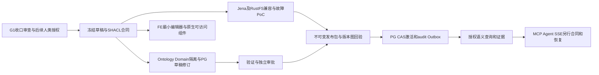

# G2 首条纵向切片：只读准备

状态：PROPOSED / NOT_RUN；仅接口、人工合成数据和依赖DAG文档。G1-CLOSE-001没有G2实施权；不创建G2功能源码、依赖、数据库或进程。不改变既有G0-G8计划。

## 候选切片与接口

本体治理最小样例Heat→CastingSequence→Slab→RollingEvent→Coil。Turtle为权威，JSON只为命令/查询传输。客户端不能指定Actor/授权厂区；复用已验证BFF主体、scope及Trace。

| 拟议接口 | 输入/输出最小合同 | 阻断条件 |
|---|---|---|
| POST /api/v1/ontology-drafts | Turtle/Shapes、CommandContext含命令ID/幂等键/expectedRevision/reason；返回draftId/revision/hashes | scope越界/类型错误/并发冲突 |
| POST /ontology-drafts/{id}/validations | 固定draftRevision/ontologyHash/shapesHash；报告标准SHACL结果和EvidenceRef | 未授权/过期修订/验证失败禁止发布 |
| POST /release-proposals | 固定修订、完整AssetVersionSnapshot、验证报告与理由 | 不可将模型输出直接发布 |
| POST /approvals/{id}/decisions | 独立审核身份、提案revision/参数hash、scope/有效期 | 修改后重新审批，禁止SSE审批 |
| POST /release-activations | 固定不可变Manifest、Jena版本图及RustFS对象哈希回验、PG CAS+audit+Outbox | 任一步未就绪保留旧active，提交响应丢失读回事实 |
| POST /semantic/queries | 受限查询、固定release/scope/预算；六态+证据/子源/数据时间 | 无权/缺证据/歧义明确，不静默合并 |
| 后续MCP/Run/SSE | 同语义服务、能力Schema/预算、PG先存事件/Last-Event-ID | 必须单独授权与恢复/重复工具/审批负例 |

以上路径承接原规划，尚未冻结正式OpenAPI或建立端点。领域项目不得依赖EF/HTTP/Jena/LLM SDK；每模块独有写边界，显式映射。

## Local/Synthetic数据样例

```turtle
@prefix ex: <urn:ontology-platform:synthetic:> .
@prefix owl: <http://www.w3.org/2002/07/owl#> .
ex:Heat a owl:Class .
ex:Coil a owl:Class .
ex:producedFrom a owl:ObjectProperty .
ex:coil-demo a ex:Coil ; ex:producedFrom ex:heat-demo .
ex:heat-demo a ex:Heat .
```

上述为人工构造、非真实冶金事实/非完整五段谱系/非因果证明。后续批准后需补五类型、Shapes正反例、双厂同号、证据缺失、修订冲突及故障样本。EvidenceRef分开来源/内容哈希/有效时间/读取时间/权限，不能把资产版本当数据时效。

## 依赖DAG与第一批验收建议



Shared Single Writer：迁移/OpenAPI/发布Manifest/工具Schema/Design Tokens。拟首批负例：SHACL失败阻发布、审批后修订失效、部署失败保旧active、重复幂等请求不重复激活、跨厂证据再次授权、回滚固定完整版本、断线后Run事件可重放。模型/生产源/许可材料缺前提须BLOCKED或Local/Synthetic，不借本准备启动外部模型。
